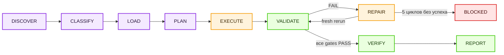

<div align="center">

# ACE-SKILL

**Skill для тех, кого заебало вручную чинить лорбуки, угадывать, почему не сработал ключ,  
и верить отчёту модели на слово.**

*SillyTavern character cards · Lorebooks / World Info  
· RU/EN keys · Проверка с доказательствами*

[](https://github.com/evrytests-maker/ace-skill)
[](LICENSE)
[](https://nodejs.org)
[](#уровни-проверки)
[](https://github.com/SillyTavern/SillyTavern)

[English version](README_EN.md)

</div>

---

## Содержание

**Для пользователя**

1. [Что это](#что-это)
2. [Быстрый старт](#быстрый-старт)
3. [Что умеет](#что-умеет)
4. [Установка](#установка)
5. [Готовые запросы](#готовые-запросы)
6. [Где тестировалось](#где-тестировалось)

**Техническое описание**

7. [Архитектура](#архитектура)
8. [Жизненный цикл задачи](#жизненный-цикл-задачи)
9. [Workflows](#workflows)
10. [Правила, валидаторы и manual gates](#правила-валидаторы-и-manual-gates)
11. [Статусы, repair loop и evidence](#статусы-repair-loop-и-evidence)
12. [Источники истины](#источники-истины)
13. [Подсистемы проверки](#подсистемы-проверки)
14. [CLI](#cli)
15. [Уровни проверки](#уровни-проверки)
16. [Структура репозитория](#структура-репозитория)
17. [v4.2 → v5](#v42--v5)
18. [Ограничения](#ограничения)

---

## Что это

`ace-skill` — skill для ИИ-агентов и чат-ботов, который превращает работу с материалами SillyTavern в проверяемый процесс: создать или починить → прогнать проверки → исправить то, что упало → показать доказательства.

Он пригодится, если ты:

- пишешь character cards с нуля или чинишь чужие;
- собираешь lorebook / World Info и устал вручную искать сломанные entries;
- работаешь с русскими и английскими ключами, regex и `keysecondary`;
- хочешь понимать, почему entry сработал или не сработал;
- не доверяешь ответу «всё проверено», пока модель не покажет реальные проверки.

> [!NOTE]
> `ace-skill` не делает модель умнее. Он задаёт ей маршрут, не даёт смешивать правила карточек и лорбуков и запрещает объявлять `PASS` без реально выполненных проверок.

---

## Быстрый старт

1. **Установи** skill в свой агент или загрузи ZIP в чат — см. [Установка](#установка).
2. **Приложи** character card, lorebook или просто опиши задачу.
3. **Напиши**, что нужно сделать:

```text
Используй ace-skill. Проверь этот lorebook и исправь все обязательные ошибки.
```

Дальше skill сам выберет подходящий workflow, прочитает только нужные справочники, выполнит задачу и проверит результат.

**Что ты получишь в ответе:**

- готовый файл или путь к нему;
- какой workflow выбран и какие правила применены;
- какие проверки запускались и что они показали;
- что сломалось на первом прогоне и как было исправлено;
- итоговый статус: `PASS`, `FAIL` или `BLOCKED` — и почему.

> [!IMPORTANT]
> `PASS` означает, что **все** обязательные проверки реально запущены и пройдены. Если хоть одна не запускалась, недоступна или её результат неизвестен — статус `BLOCKED`, а не «наверное, всё нормально».

---

## Что умеет

| Задача | Что делает ace-skill |
|---|---|
| Character cards | создаёт и чинит V1/V2/V3-карточки: структура, характер, greeting, голос, token budget |
| Lorebooks / World Info | создаёт, проверяет и чинит entries, позиции, группы, recursion, probability, sticky/cooldown/delay |
| Keys и regex | проектирует и тестирует обычные ключи и JavaScript regex на положительных и отрицательных примерах |
| Secondary logic | проверяет `keysecondary`, `selective` и все четыре режима `selectiveLogic` по truth table |
| Активация entries | показывает, какие entries сработали, проиграли или были отброшены — с UID/index и причиной |
| Token budget | считает токены по выбранному профилю и явно пишет, где точный подсчёт, а где оценка |
| Стиль | ловит запрещённые риторические шаблоны и проверяет художественные поля через manual gates |
| Карточка + лорбук | чинит оба артефакта в одной задаче, но проверяет их раздельно |

---

## Установка

Сначала определи, в каком режиме ты работаешь:

| Режим | Где | Что доступно |
|---|---|---|
| **Чат-бот** | ChatGPT, Claude.ai, Grok и другие веб-чаты | инструкции, справочники, ручные проверки; автоматические — только если чат умеет запускать Node.js |
| **Агент** | Codex, Claude Code, Antigravity, OpenCode, Cursor, Cline, Roo Code | всё, включая `verify.mjs`, CLI, валидаторы и тесты |

> [!TIP]
> Полный автоматический `PASS` возможен только там, где модель реально может выполнять команды. В веб-чатах без исполнения кода честный итог для автоматических проверок — `BLOCKED`.

### Чат-боты

#### Как скачать ZIP с GitHub

Открой репозиторий, нажми **Code** → **Download ZIP**:


GitHub называет папку внутри архива `ace-skill-main/`. Если интерфейс устанавливает skills и ругается на имя, переименуй папку в `ace-skill/` — оно должно совпадать с полем `name` в `SKILL.md`.

#### ChatGPT

**Вариант 1 — Personal Skill.** Если в аккаунте доступен раздел [ChatGPT Skills](https://chatgpt.com/skills):

1. Создай новый skill или выбери загрузку с компьютера.
2. Загрузи ZIP с папкой `ace-skill/` и файлом `SKILL.md` внутри.
3. Вызови `ace-skill` явно или просто дай подходящую задачу.

**Вариант 2 — ZIP прямо в чат.** Если Personal Skills недоступны, приложи архив и напиши:

```text
Используй ace-skill из архива. Начни с SKILL.md и выполни "X".
```

#### Claude.ai

1. Если в интерфейсе доступна загрузка custom Skills (**Settings → Capabilities → Skills**), установи ZIP как skill. Иначе загрузи архив прямо в чат.
2. Приложи character card, lorebook или текст задачи.
3. Напиши:

```text
Используй ace-skill из архива. Начни с SKILL.md, выбери подходящий workflow и читай только нужные файлы.

Выполни задачу, покажи evidence и не объявляй полный PASS, если обязательные JavaScript-проверки не были реально запущены.
```

#### Grok.com

Рекомендуемый режим — **Expert**.

1. Загрузи ZIP на grok.com.
2. Приложи character card, lorebook или текст задачи.
3. Напиши:

```text
Используй ace-skill из архива. Начни с SKILL.md, выбери один workflow и не читай весь архив без необходимости.

Покажи, что было проверено, какие ошибки найдены, что исправлено, какие проверки были повторены и какие недоступны.

Не выдавай BLOCKED или неизвестный результат за PASS.
```

#### Другие чат-боты

Если чат принимает ZIP или несколько файлов — загрузи архив и проверяемый материал, затем:

```text
Используй ace-skill из загруженного архива.

SKILL.md — главная входная точка. Выбери один подходящий workflow и читай только необходимые для него файлы.

Выполни задачу и покажи evidence для каждой доступной проверки.

Если интерфейс не позволяет запускать JavaScript или Node.js, явно укажи это и верни BLOCKED для недоступных обязательных проверок.
```

### Агенты

Агенты работают с локальными файлами, поэтому могут запускать `verify.mjs`, CLI, валидаторы и тесты. Для полной проверки нужен **Node.js 20+**.

После установки в любом агенте полезно сразу проверить пакет — см. [Проверить установку](#проверить-установку).

#### Codex

Codex ищет skills в `.agents/skills`.

```bash
# Для всех проектов
mkdir -p "$HOME/.agents/skills"
git clone https://github.com/evrytests-maker/ace-skill.git "$HOME/.agents/skills/ace-skill"

# Только для текущего репозитория
mkdir -p .agents/skills
git clone https://github.com/evrytests-maker/ace-skill.git .agents/skills/ace-skill
```

Если репозиторий уже скачан, вместо `git clone` используй `cp -R /path/to/ace-skill <каталог>/ace-skill`.

Вызов:

```text
$ace-skill Проверь этот lorebook и исправь все обязательные ошибки.
```

Можно и обычной фразой — `Используй ace-skill для этой задачи.` Codex также выбирает skill сам, если запрос совпадает с его `description`.

#### Claude Code

Claude Code ищет skills в `~/.claude/skills/` (для всех проектов) и `.claude/skills/` (для текущего проекта).

```bash
# Для всех проектов
mkdir -p "$HOME/.claude/skills"
git clone https://github.com/evrytests-maker/ace-skill.git "$HOME/.claude/skills/ace-skill"

# Только для текущего проекта
mkdir -p .claude/skills
git clone https://github.com/evrytests-maker/ace-skill.git .claude/skills/ace-skill
```

Вызов — `/ace-skill <задача>` или обычной фразой. Claude Code также подключает skill автоматически по `description`.

Если skill лежит просто внутри проекта (без каталога skills), укажи путь явно:

```text
Используй ./ace-skill/SKILL.md как входную точку skill.

Выбери подходящий workflow, читай только нужные references и запусти доступные проверки через Node.js.
```

#### Antigravity

Открой папку проекта и склонируй `ace-skill` внутрь рабочего пространства:

```bash
git clone https://github.com/evrytests-maker/ace-skill.git
```

```text
project/
├── ace-skill/
│   ├── SKILL.md
│   ├── verify.mjs
│   └── ...
├── card.json
└── lorebook.json
```

Запрос:

```text
Используй ./ace-skill/SKILL.md как входную точку skill.

Выбери один подходящий workflow, читай только разрешённые им файлы, выполни задачу и запусти доступные Node.js-проверки.

Не объявляй PASS без evidence.
```

#### OpenCode, Cursor, Cline, Roo Code

Склонируй `ace-skill` в корень рабочего проекта (или рядом с проверяемыми файлами):

```bash
git clone https://github.com/evrytests-maker/ace-skill.git
```

Запрос в агентном чате:

```text
Используй ./ace-skill/SKILL.md как главную инструкцию для этой задачи.

Выбери один workflow, открывай только нужные правила, выполни задачу и запусти доступные validators.
После исправлений повторно запусти упавшие проверки. Не объявляй PASS без evidence.
```

#### Другие локальные агенты

| Возможность агента | Что сделать |
|---|---|
| поддерживает Agent Skills | установи папку `ace-skill/` в его каталог skills |
| работает с локальным репозиторием | положи `ace-skill/` внутрь проекта и укажи путь к `SKILL.md` |
| умеет запускать Node.js | сначала `node verify.mjs`, затем нужные команды CLI |
| умеет только читать файлы | используй инструкции, но не жди автоматического `PASS` |
| ограничивает контекст | начни с `SKILL.md`, references открывай только по выбранному workflow |
| не показывает вывод команд | автоматические проверки считаются неподтверждёнными → `BLOCKED` |

### Проверить установку

Быстрая проверка пакета не требует `npm install`, сети и зависимостей:

```bash
node verify.mjs                     # из папки skill
node ace-skill/verify.mjs ace-skill # из корня проекта
node verify.mjs path/to/ace-skill.zip
```

Ожидаемый результат:

```text
ACE WEB PRECHECK: PASS
```

> [!IMPORTANT]
> Это проверка целостности пакета, а не release `PASS` и не оценка твоей карточки или лорбука. Полная проверка описана в разделе [Уровни проверки](#уровни-проверки).

---

## Готовые запросы

<details>
<summary><strong>Создать character card</strong></summary>

```text
Используй ace-skill. Создай SillyTavern character card по моему описанию.
Сохрани инициативу пользователя, сделай живое greeting и проверь структуру, стиль и token budget.
```

</details>

<details>
<summary><strong>Починить существующую карточку</strong></summary>

```text
Используй ace-skill. Найди проблемы в этой character card, исправь их без потери характера
и покажи, какие проверки были запущены повторно после ремонта.
```

</details>

<details>
<summary><strong>Проверить lorebook</strong></summary>

```text
Используй ace-skill. Проверь lorebook на структуру, ключи, secondary logic, группы, recursion,
timed effects и token budget. Исправь обязательные ошибки и сохрани UID каждого entry в отчёте.
```

</details>

<details>
<summary><strong>Проверить regex key</strong></summary>

```text
Используй ace-skill. Проверь этот ключ именно с JavaScript regex semantics.
Он должен находить: Годжо, Gojo, Сатору.
Он не должен находить: год, go, Сат.
```

</details>

<details>
<summary><strong>Проверить card и lorebook вместе</strong></summary>

```text
Используй ace-skill. Исправь character card и связанный lorebook в одном задании,
но проверь их отдельными gate-наборами и не смешивай правила двух доменов.
```

</details>

---

## Где тестировалось

Среды, в которых автор вручную проверял `ace-skill`. Это практический опыт автора, а не результат автоматических тестов репозитория.

| Среда | Модель | Уровень рассуждения | Как использовалось |
|---|---|---|---|
| Codex | GPT-5.6 Terra | high, в основном xhigh | разработка, аудит репозитория, исправления и полные локальные проверки |
| Codex | GPT-5.6 Sol | high, в основном xhigh | повторная проверка workflow, скриптов и evidence |
| ChatGPT | GPT-5.6 Sol | high | работа с загруженным ZIP, web-compatible сценарий |
| grok.com | Expert | — | работа с загруженным ZIP, web-compatible сценарий |
| claude.ai | Claude Sonnet 4.6 | high/max | работа с загруженным ZIP, выбор workflow и проверка инструкций |

Архитектура рассчитана на перенос в другие совместимые модели и агенты, но неперечисленные среды не считаются протестированными.

> [!CAUTION]
> Результат на конкретной модели зависит от поддержки Skills, доступа к файлам и возможности выполнять команды. Таблица не является оценкой качества самих моделей и не обещает одинаковый результат везде.

---

# Техническое описание

## Архитектура

`ace-skill` состоит из трёх слоёв, которые разделяют «что делать», «по каким правилам» и «чем это проверить»:

| Слой | Файлы | Назначение |
|---|---|---|
| **Инструкции для модели** | `SKILL.md`, `references/*.md`, `AI_CHECK_INDEX.md` | точка входа, state machine, инварианты, доменные справочники. `SKILL.md` — единственный model-neutral вход для всех агентов |
| **Машиночитаемые правила** | `rules/*.json`, `rules/guide/*.json`, `schemas/*.json` | реестр правил, workflows, manual gates, источники и конфликты, rule packs по World Info. Всё валидируется JSON Schema |
| **Исполняемые проверки** | `scripts/ace.mjs`, `scripts/services/*`, `scripts/lib/*`, `verify.mjs` | единый CLI над изолированными сервисами, симулятор World Info, dependency-free precheck пакета |

Плюс контур самопроверки: `tests/` (unit, e2e, sabotage/mutant) и `evals/` (trigger и behavior evals).

Ключевые решения:

- **Одна точка входа.** Нет параллельных model-specific веток: Codex, Claude, ChatGPT и остальные идут по одному `SKILL.md`.
- **Правила — данные, а не проза.** Модель получает проекцию нужного workflow из реестров (`ace.mjs workflow <id>`), а не перечитывает длинный Markdown. Текст правил не дублируется.
- **Progressive disclosure.** Сначала inventory входных файлов (типы, размеры, количество записей), потом классификация, потом чтение только разрешённых references. Файлы > 20 KiB читаются точечно.
- **Изоляция доменов.** Правила карточек и лорбуков не смешиваются: у каждого workflow есть списки `requiredReferences` и `forbiddenReferences`.
- **Fail-closed.** Всё неизвестное, незапущенное или противоречивое считается провалом, а не успехом.

---

## Жизненный цикл задачи

Каждая задача проходит фиксированную state machine:



| Состояние | Что происходит |
|---|---|
| `DISCOVER` | инвентаризация входных артефактов и ограничений; недостающие данные запрашиваются, только если их нельзя извлечь из файлов |
| `CLASSIFY` | выбор ровно одного workflow; `node scripts/ace.mjs workflow <id> --json` возвращает его правила, валидаторы, gates, источники и конфликты |
| `LOAD` | чтение обязательных references с записью пути и SHA-256; чтение запрещённого reference — нарушение `ACE-CORE-002` |
| `PLAN` | каждое применимое правило связывается с результатом и gate; «осиротевший» MUST блокирует продолжение |
| `EXECUTE` | создание или ремонт артефакта с сохранением ограничений пользователя |
| `VALIDATE` | запуск всех применимых валидаторов через CLI и ответы на manual gates с цитатами полей |
| `REPAIR` | фиксация провала → исправление → повторный запуск того же gate с чистого состояния; максимум 5 полных циклов |
| `VERIFY` | повторное открытие финальных файлов, валидация evidence ledger; при наличии — независимый грейдер со свежим контекстом |
| `REPORT` | статус по каждому gate и итоговый статус по контракту вывода |

---

## Workflows

Реестр — `rules/workflows.json`. Каждая задача классифицируется ровно в один workflow:

| Workflow | Когда | Валидаторы | Manual gates |
|---|---|---|---|
| `character-create` | новая карточка или её поля | CARD, STYLE, TOKENS, EVIDENCE | CHARACTERIZATION, GREETING, VOICE, STYLE-CONTRAST |
| `character-repair` | аудит/ремонт карточки | CARD, STYLE, TOKENS, EVIDENCE | CHARACTERIZATION, GREETING, VOICE, STYLE-CONTRAST |
| `lorebook-create` | новый World Info / lorebook | LORE, KEY, SECONDARY, STYLE, TOKENS, SOURCES, EVIDENCE | LORE-SEMANTICS, LORE-KEYS, STYLE-CONTRAST |
| `lorebook-audit` | аудит/ремонт лорбука | LORE, KEY, SECONDARY, STYLE, TOKENS, SOURCES, EVIDENCE | LORE-SEMANTICS, LORE-KEYS, STYLE-CONTRAST |
| `key-regex-test` | дизайн и тест ключей/regex | KEY, SOURCES, EVIDENCE | LORE-KEYS |
| `secondary-logic-test` | truth table secondary keys | LORE, KEY, SECONDARY, SOURCES, EVIDENCE | — |
| `token-budget` | только подсчёт токенов | TOKENS, EVIDENCE | — |
| `combined-repair` | карточка и лорбук вместе | все доменные | все доменные + COMBINED-SEPARATION |
| `skill-maintenance` | изменение самого ace-skill | RULES, DOCS, SOURCES, LANGUAGE, EVIDENCE, EVAL-DATA | — |

Префиксы `VAL-` и `MG-` опущены. Справочники по доменам: карточки — `references/character-cards.md`, лорбуки — `references/lorebooks.md`, ключи — `references/keys-and-regex.md`; для `combined-repair` загружаются все три, но gates и evidence ведутся раздельно (`ACE-OUTPUT-001`).

---

## Правила, валидаторы и manual gates

### Реестр правил

`rules/registry.json` — 26 правил с уровнем, scope и привязкой к валидаторам. Уровни:

| Уровень | Смысл |
|---|---|
| `MUST` | применимый провал блокирует `PASS` |
| `SHOULD` | по умолчанию соблюдается; исключение требует записанной причины |
| `MAY` | метод на выбор агента |
| `JUDGMENT` | качество обязательно, но художественный метод не предписан — проверяется manual gate |

Группы правил:

| Группа | Что покрывает |
|---|---|
| `ACE-TRIGGER-*`, `ACE-CORE-*` | когда активироваться, порядок state machine, обязательное чтение references, запрет `PASS` без свежего evidence, repair loop |
| `ACE-CARD-*` | структурный контракт V1/V2/V3, характер через поведение, играбельный greeting без решений за пользователя, голос в примерах диалогов, advisory 700–1500 токенов |
| `ACE-LORE-*` | валидная структура entries, `selectiveLogic` строго `0..3`, `selective=true` при непустых secondary keys, смысловая самодостаточность entries |
| `ACE-KEY-*` | JavaScript regex semantics, положительные и отрицательные кейсы, семантическая связь ключа с содержимым |
| `ACE-STYLE-*` | запрет риторики «X — не A, а B» на уровне шаблонов и смысла (RU и EN) |
| `ACE-TOKEN-*` | указание метода подсчёта, запрет выдавать оценку за точный подсчёт |
| `ACE-SOURCE-*` | технические утверждения о SillyTavern — только из официального источника, конфликты разрешаются явно |
| `ACE-REPO-*`, `ACE-OUTPUT-*` | целостность репозитория, покрытие каждого MUST валидатором и тестом, английский язык активной прозы, self-contained исполнение, разделение доменов в combined-задачах |

Агент не имеет права выдумывать ID правил: всё, на что он ссылается, должно существовать в реестре.

### Валидаторы

18 валидаторов в реестре. Доменные:

| ID | Команда | Что проверяет |
|---|---|---|
| `VAL-CARD` | `validate card` | определение версии V1/V2/V3, `spec`/`spec_version`, обязательные строковые поля, `extensions`, `assets`, `character_book` |
| `VAL-LORE` | `validate lorebook` | контейнер `entries` (объект или массив), типы полей, целочисленные ID, конфликтующие алиасы полей, неизвестный `selectiveLogic` без fallback, подсказки для опечаток в именах полей |
| `VAL-KEY` | `key` | компиляция ключа, positive/negative кейсы, secondary keys с `--logic 0..3`, макросы `{{char}}`/`{{user}}` |
| `VAL-SECONDARY` | `secondary` | полная truth table `keysecondary` × `selectiveLogic` |
| `VAL-STYLE` | `validate style` | шаблоны contrastive negation (`EN-NOT-BUT`, `RU-NE-A-NO` и варианты с повтором/именованным субъектом) |
| `VAL-TOKENS` | `tokens` | подсчёт по полям, метод (`exact`/`estimate`/`mixed`), бюджет, advisory для карточки |
| `VAL-SIMULATOR` | тесты симулятора | модель пайплайна World Info, обязательна для «продвинутых» лорбуков |
| `VAL-SOURCES` | `validate sources` | свежесть (`reviewDue`), иерархия и разрешённость конфликтов источников |
| `VAL-EVIDENCE` | `validate evidence` | структура и полнота evidence ledger |

Репозиторные: `VAL-SYNTAX`, `VAL-RULES`, `VAL-DOCS`, `VAL-LANGUAGE`, `VAL-UNIT`, `VAL-E2E`, `VAL-SABOTAGE`, `VAL-EVAL-DATA`, `VAL-EVAL`.

### Manual gates

То, что нельзя честно свести к автоматической проверке, проверяется структурированными вопросами из `rules/manual-gates.json`. Ответ обязан опираться на прямые цитаты из полей артефакта.

| Gate | Вопрос |
|---|---|
| `MG-CARD-CHARACTERIZATION` | мотивация показана через поведение, внутреннее состояние отделено от внешней манеры? |
| `MG-CARD-GREETING` | greeting даёт играбельный старт, не решая за пользователя мысли, реплики и выборы? |
| `MG-CARD-VOICE` | примеры диалогов показывают нужный голос и не противоречат карточке? |
| `MG-LORE-SEMANTICS` | entry понятен при активации и ограничен нужной информацией? |
| `MG-LORE-KEYS` | ключи узнают тему entry в языке чата без широких ложных срабатываний? |
| `MG-STYLE-CONTRAST` | проза свободна от replacement-by-negation, включая разорванные и перефразированные варианты? |
| `MG-COMBINED-SEPARATION` | карточка и лорбук получили раздельные references, правила, валидаторы, gates и evidence? |

---

## Статусы, repair loop и evidence

### Статусы и коды выхода

| Статус | Exit code | Значение |
|---|---|---|
| `PASS` | `0` | проверка выполнена и пройдена |
| `FAIL` | `1` | валидация не пройдена |
| — | `2` | ошибка использования или входных данных |
| `BLOCKED` | `3` | проверка не может быть выполнена: нет возможности, нет входа или 5 циклов ремонта не помогли |
| `N/A` | — | gate неприменим; требует зарегистрированной причины и перечня проверенных полей |

Итоговый `PASS` требует, чтобы все применимые MUST и manual gates были `PASS`, не было ни одного `FAIL`/`BLOCKED`, а каждое `N/A` было обосновано. `PASS` блокируется также при отсутствии вывода команды, неизвестном значении критического поля и неразрешённом конфликте источников.

### Repair loop

Для каждого провала сохраняются: упавший rule/gate и причина → исправление → повторный запуск того же gate с чистого состояния. В evidence остаются **обе** попытки — провальная и исправленная. Если та же обязательная проблема остаётся после пяти полных циклов, итог — `BLOCKED`.

### Evidence ledger

Evidence — это реальный результат команды, выдержка или hash артефакта, событие транскрипта или независимое ревью. Галочка или утверждение модели evidence не являются.

Ledger описан в `schemas/evidence.schema.json` и содержит: `runId`, `repoHead`, `revisionKind`, `workflowId`, `artifactType`, `startedAt`/`finishedAt`, `inputs`, `transitions` (переходы state machine), `references` (путь + SHA-256), `gates` (команда, exit code, hash, повторные прогоны) и `overallStatus`. Репозиторные проверки пишут ledger в `.ace-reports/`.

В отчётах по лорбуку для каждой строки сохраняются UID/index entry, путь к исходному полю, финальный статус и стабильный код причины — сжатый отчёт не имеет права терять provenance из трассы.

---

## Источники истины

Техническое поведение SillyTavern берётся только из официального кода и документации. `rules/sources.json` задаёт иерархию:

```text
official-source > official-documentation > observed-behavior > local-practical-guide > community-guide > legacy-ace
```

- **17 источников**, официальный код закреплён на ревизии SillyTavern [`8172dcd`](https://github.com/SillyTavern/SillyTavern/blob/8172dcd0ee672d3cd9a5e5f7af134f91a45cd2b8/public/scripts/world-info.js) (`world-info.js`, `macros.js`, `TavernCardValidator.js`). Копия ключевой справки — в `upstream/`.
- У каждого источника есть `checkedAt` и `reviewDue`. Просроченный источник роняет `VAL-SOURCES` — устаревшие знания не проходят молча.
- **4 зарегистрированных конфликта** между гайдами и реализацией (подсчёт scan depth, слияние vector-результатов, «жёсткие» творческие лимиты, дефолтная стратегия вставки World Info) с явными резолюциями.
- **Rule packs** `rules/guide/*.json` — 92 правила в 7 тематических пакетах (формат и entries; сканирование и ключи; размещение, probability и budget; recursion и группы; timed effects и фильтры; векторы; карточка). Community-гайды в них квалифицированы закреплённым официальным источником: при расхождении побеждает код.
- Исполнение self-contained: внешние URL нужны только для provenance, во время работы ничего не скачивается.

---

## Подсистемы проверки

### Симулятор World Info

`scripts/lib/world-info-simulator.mjs` — детерминированная модель пайплайна World Info, повторяющая поведение официальной ветки `release`:

- scan buffer с учётом `scanDepth` (считается по сообщениям), имён участников и макросов;
- primary/secondary keys, plaintext и regex, case sensitivity и whole words;
- фильтры по персонажам и тегам, `constant`, `enabled`;
- группы, group scoring, веса и `groupOverride`;
- recursion с `excludeRecursion` / `preventRecursion` / `delayUntilRecursion` и лимитом шагов;
- timed effects `sticky` / `cooldown` / `delay`;
- `probability` через seeded PRNG — результат воспроизводим;
- стратегии источников (character first, global first, evenly), `minActivations`, token budget и `ignoreBudget`;
- позиции вставки (`before_char` … `at_depth`, `outlet`), сборка prompt skeleton и раскрытие Outlet-макросов;
- vector retrieval — через явный adapter; реальные embeddings и Quick Reply остаются runtime-зависимыми и не выдаются за runtime `PASS`.

Каждое решение попадает в трассу с причиной: сработал, проиграл в группе, отброшен по бюджету, заблокирован таймером и т. д.

### Ключи и regex

Ключи проверяются строго с семантикой JavaScript `RegExp` — Python regex финальным evidence не считается. Требуются и положительные, и осмысленные отрицательные кейсы. Русские regex, ключи и тестовые литералы хранятся байт-в-байт и никогда не переводятся. `--syntax-only` проверяет только компиляцию и не даёт поведенческий `PASS`. `lorebook-keys` прогоняет весь лорбук по тексту чата с ожидаемыми активными/неактивными entries.

### Токены

| Профиль | Токенайзер | Метод |
|---|---|---|
| `gpt-5`, `gpt-4o` | `o200k_base` | точный (`gpt-tokenizer`) |
| `gpt-3.5` | `cl100k_base` | точный (`gpt-tokenizer`) |
| `claude`, `gemini`, `llama`, `mistral`, `generic` | — | оценка по классам символов (латиница, кириллица, CJK, цифры, пунктуация) |

Метод всегда указывается в отчёте; если поля посчитаны разными методами — `mixed`. `--require-exact` возвращает `BLOCKED`, когда точного токенайзера нет; `--budget N` даёт `FAIL` при превышении. Для полной карточки диапазон 700–1500 токенов — только advisory: вне диапазона `WARN` с фактическим числом, карточка из-за этого не проваливается.

### Стиль

Запрет replacement-by-negation («X — не A, а B», «не A, но B» и эквиваленты) работает в два слоя: `VAL-STYLE` ловит шаблоны на русском и английском, `MG-STYLE-CONTRAST` ловит смысловые варианты, которые обходят шаблоны. Обычное фактическое отрицание без подмены разрешено.

### Precheck пакета

`verify.mjs` — один процесс Node.js, только встроенные модули, без сети, npm и временных файлов. Принимает папку skill, родительскую папку с несколькими skills, ZIP или любой файл внутри установленного skill. Проверки: метаданные `SKILL.md`, структура и обязательные файлы, SHA-256 всех файлов по `verification-manifest.json`, валидность JSON, локальные Markdown-ссылки, регистр путей, `package.json`, контракт Outlet, конфликты источников, структура release gate. Предупреждает о `.git`, `node_modules`, `.ace-reports` и больших файлах.

---

## CLI

Все проверки идут через единый `scripts/ace.mjs`. Доменные команды:

```bash
node scripts/ace.mjs validate card card.json
node scripts/ace.mjs validate lorebook lorebook.json
node scripts/ace.mjs validate style artifact.json

# Один ключ с положительным и отрицательным примером
node scripts/ace.mjs key \
  --key '/(?:Годжо|Gojo)/iu' \
  --should-match 'Годжо вошёл в комнату' \
  --should-not-match 'Это был обычный год'

# Весь лорбук против текста чата
node scripts/ace.mjs lorebook-keys lorebook.json --text 'Годжо вошёл' --expect-active 3

# Secondary logic
node scripts/ace.mjs secondary tests/key-fixtures/secondary_lorebook.json

# Токены
node scripts/ace.mjs tokens card.json --model gpt-4o --budget 1500

# Проекция workflow: правила, валидаторы, gates, источники
node scripts/ace.mjs workflow lorebook-audit --json
```

Сервисные: `validate rules|docs|sources|language`, `validate evidence <ledger.json>`, `repo syntax|fast|all`, `eval triggers|behavior|all`. Флаг `--json` даёт машиночитаемый вывод у всех команд. Полная справка — `node scripts/ace.mjs --help`, карта проверок — `AI_CHECK_INDEX.md`.

---

## Уровни проверки

| Уровень | Команда | Что подтверждает | Требования |
|---|---|---|---|
| Precheck | `node verify.mjs` / `npm run check:web` | целостность и структура пакета | только Node.js 20+ |
| Local | `npm run check:local` | быстрый gate: синтаксис, правила, доки, источники, язык, доменные валидаторы на fixtures, симулятор, unit/sabotage/e2e, evidence | `npm ci` |
| Release | `npm run check:all` | всё из Local плюс валидация данных evals — полный локальный release gate | `npm ci` |
| Runtime | `npm run check:runtime` | trigger и behavior evals на реальной модели | внешний model runner, иначе `BLOCKED` |

```bash
npm ci --ignore-scripts --no-audit --no-fund
npm run check:local
npm run check:all
npm run check:runtime
```

Тестовый контур:

- **unit** — CLI-контракт, сервисы, truth table, токены, язык, self-contained, официальная семантика World Info, симулятор;
- **e2e** — сборка prompt skeleton с provenance и Outlet;
- **sabotage / mutant** — намеренно испорченные состояния: ложный `PASS`, подменённые данные, потерянный provenance, сломанная secondary logic, мутанты валидаторов. Проверяют, что ace-skill их ловит;
- **evals** — trigger evals с train/validation-разбиением (когда skill должен и не должен активироваться) и behavior evals с грейдером (`evals/grader.md`).

---

## Структура репозитория

```text
ace-skill/
├── SKILL.md                     # точка входа для модели
├── AI_CHECK_INDEX.md            # какую проверку запускать
├── README.md / README_EN.md     # документация
├── verify.mjs                   # dependency-free precheck папки/ZIP
├── verification-manifest.json   # SHA-256 файлов и требования к пакету
├── package.json                 # npm-скрипты, Node.js 20+, devDependencies
│
├── references/                  # доменные справочники для модели
│   ├── character-cards.md
│   ├── lorebooks.md
│   ├── keys-and-regex.md
│   ├── sources-and-conflicts.md
│   ├── skill-architecture-research.md
│   └── migration-notes.md
│
├── rules/
│   ├── registry.json            # правила и валидаторы
│   ├── workflows.json           # 9 workflows
│   ├── manual-gates.json        # структурированные ручные проверки
│   ├── sources.json             # источники, иерархия, конфликты
│   ├── language-exceptions.json # разрешённые кириллические литералы
│   ├── maintenance-exclusions.json
│   └── guide/                   # 7 rule packs по World Info и карточкам
│
├── schemas/                     # JSON Schema для rules, workflows, gates, sources, evidence
├── scripts/
│   ├── ace.mjs                  # единый CLI
│   ├── token_model_map.mjs      # профили токенайзеров
│   ├── services/                # card, lorebook, key, secondary, style, tokens, workflow, repo-check
│   └── lib/                     # симулятор World Info, enforcement, evidence, IO, matching
├── tests/                       # unit, e2e, sabotage, fixtures
├── evals/                       # trigger/behavior evals, входные данные, грейдер
├── assets/                      # шаблоны card/lorebook, изображения README
└── upstream/                    # закреплённая официальная справка SillyTavern
```

Зависимости (только dev): `ajv` — валидация схем, `gpt-tokenizer` — точный подсчёт для OpenAI, `yaml` — разбор frontmatter.

---

## v4.2 → v5

v4.2 была папкой с инструкциями, справочниками и отдельными скриптами. v5 — цельная система: один вход, один маршрутизатор задач, один CLI, машиночитаемые правила, обязательный repair loop и evidence, без которого нельзя объявить `PASS`.

| Область | v4.2 | v5.0 |
|---|---|---|
| Входная точка | общий `SKILL.md` + отдельный GPT-слой | один model-neutral `SKILL.md` |
| Выбор задачи | текстовые инструкции | ровно один workflow из registry |
| Правила | prose-документы | rule registry, workflows, manual gates, schemas, source conflicts |
| Проверки | отдельные скрипты | единый CLI `scripts/ace.mjs` |
| Поведение при ошибке | объяснение проблемы | `FAIL → repair → fresh rerun`, до 5 циклов |
| Финальный статус | зависел от честности модели | fail-closed |
| Evidence | разрозненные результаты | ledger с командами, exit codes, hashes и повторными прогонами |
| Контекст | много справочников сразу | progressive disclosure |
| Технические источники | практические инструкции | закреплённый официальный SillyTavern + реестр конфликтов |
| Проверка ZIP | полноценная среда или ручной осмотр | `verify.mjs` без сети и npm |
| Тесты | regression | unit, e2e, trigger/behavior evals, sabotage/mutant |

Подробности миграции — `references/migration-notes.md`.

---

## Ограничения

- `ace-skill` проверяет только то, к чему у агента есть доступ. Без выполнения команд полный автоматический `PASS` невозможен.
- Художественное качество не сводится к числу — для него используются manual gates, а не жёсткие лимиты длины.
- Точный подсчёт токенов есть только для токенайзеров OpenAI; для остальных профилей — оценка, и это всегда указано.
- Поведение SillyTavern меняется между версиями. Технические утверждения привязаны к закреплённой ревизии и требуют обновления источников, когда наступает `reviewDue`.

---

## Лицензия

MIT — см. [LICENSE](LICENSE).
