<div align="center">

# ACE-SKILL

**Skill для тех, кого заебало вручную чинить лорбуки, угадывать, почему не сработал ключ,  
и верить отчёту модели на слово.**

*SillyTavern character cards · Lorebooks / World Info  
· RU/EN keys · Проверка с доказательствами*

[](https://github.com/evrytests-maker/ace-skill)
[](LICENSE)
[](https://nodejs.org)
[](#локальные-проверки)
[](https://github.com/SillyTavern/SillyTavern)

[English version](README_EN.md)

</div>

---

## Что это и кому оно нужно

`ace-skill` помогает нейросети создавать, проверять и чинить материалы для SillyTavern по одному понятному процессу.

Он пригодится, если ты:

- пишешь character cards с нуля;
- собираешь lorebook / World Info и устал вручную искать сломанные entries;
- работаешь с русскими и английскими ключами, regex и `keysecondary`;
- хочешь понимать, почему entry сработал или не сработал;
- не доверяешь ответу «всё проверено», пока модель не покажет реальные проверки;
- хочешь проверить почти всё, что связано с карточкой персонажа.

> [!NOTE]
> `ace-skill` не заменяет модель и не делает её магически умнее. Он задаёт ей маршрут работы, не даёт смешивать разные правила и заставляет подтверждать результат проверками.

---

## Как использовать за минуту

1. Установи skill или загрузи ZIP в чат.

2. Приложи character card, lorebook либо текст задачи.

3. Напиши, что нужно сделать.

4. `ace-skill` выберет подходящий workflow, прочитает только нужные материалы, выполнит задачу и проверит результат.

Пример запроса:

```text
Используй ace-skill. Проверь этот lorebook, создай карточку персонажа с лорбуком и RU regex-ключами.
```

---

## Как работает skill

```mermaid
flowchart LR
    A["Ты даёшь задачу"] --> B["Агент читает SKILL.md"]
    B --> C["Выбирает workflow"]
    C --> D["Создаёт или исправляет"]
    D --> E["Проверяет результат"]
    E -->|Есть ошибки| D
    E -->|Всё прошло| F["Отдаёт результат и evidence"]

    classDef blueviolet fill:#f4eaff,stroke:#8a2be2,color:#241238,stroke-width:2px;
    classDef orange fill:#fff3dc,stroke:#f59e0b,color:#3d2600,stroke-width:2px;
    classDef green fill:#e9f7ed,stroke:#16803a,color:#0d3b1d,stroke-width:2px;
    classDef success fill:#eaffdf,stroke:#44cc11,color:#173d08,stroke-width:2px;

    class A,B,C blueviolet;
    class D orange;
    class E green;
    class F success;

    linkStyle default stroke:#6b7280,stroke-width:1.5px;
```



### Что происходит после запуска

1. **Разбирается в задаче**
   Определяет, что ты прислал и какой результат тебе нужен. Лишние файлы без необходимости не открывает.

2. **Подбирает нужные правила**
   Выбирает подходящий workflow и загружает только те инструкции, справочники и проверки, которые относятся к задаче.

3. **Создаёт или исправляет материал**
   Работает с карточкой персонажа, lorebook, ключами, regex или другими связанными файлами.

4. **Проверяет полученный результат**
   Запускает доступные автоматические проверки и отдельно проходит пункты, которые требуют ручной оценки.

5. **Исправляет найденные проблемы**
   Не ограничивается списком ошибок: вносит исправления и повторно запускает проверки, которые не прошли.

6. **Перепроверяет финальную версию**
   Убеждается, что проверки относятся именно к последним сохранённым файлам, а не к их старой версии.

7. **Отдаёт результат с доказательствами**
   Показывает, что было найдено, что изменено, какие проверки выполнены и чем подтверждён итоговый статус.

> [!IMPORTANT]
> `PASS` означает, что все обязательные проверки действительно были выполнены и успешно пройдены. Если хотя бы одна обязательная проверка не запускалась, недоступна или её результат неизвестен, итоговый статус должен быть `BLOCKED`.

---

## Что умеет

| Задача | Что делает ace-skill |
|---|---|
| Character cards | создаёт и ремонтирует V1/V2/V3-карточки, проверяет структуру, характер, greeting, голос и token budget |
| Lorebooks / World Info | создаёт, анализирует и чинит entries, позиции, группы, recursion, probability, sticky/cooldown/delay и другие настройки |
| Keys и regex | проектирует и тестирует обычные ключи и JavaScript regex на положительных и отрицательных примерах |
| Secondary logic | проверяет `keysecondary`, `selective` и все режимы `selectiveLogic` по truth table |
| Активация entries | показывает, какие entries победили, проиграли или были отброшены, сохраняя UID/index и причину |
| Token budget | считает токены по выбранному профилю и явно пишет, где точный подсчёт, а где оценка |
| Стиль | ловит запрещённые шаблоны и проверяет художественные поля отдельными manual gates |
| Самопроверка skill | проверяет правила, документацию, источники, тесты, evals, sabotage cases и целостность ZIP |

---

## Установка и запуск

### Чат-боты
#### Как скачать ZIP с GitHub

Открой репозиторий, нажми **Code** → **Download ZIP**:


Если интерфейс поддерживает Skills, установи папку `ace-skill/` как skill. Если такой функции нет, загрузи ZIP прямо в диалог и укажи `SKILL.md` как главную входную точку.

Такие интерфейсы могут читать инструкции, references и проверяемые файлы. Полный автоматический `PASS` допустим только тогда, когда интерфейс действительно позволяет запускать обязательные команды.

#### ChatGPT

##### Вариант 1 — установить как Personal Skill

1. Если в твоём аккаунте доступен раздел [ChatGPT Skills](https://chatgpt.com/skills), открой его.
2. Создай новый skill или выбери загрузку skill с компьютера.
3. Загрузи ZIP с папкой `ace-skill/` и файлом `SKILL.md` внутри.
4. В чате явно вызови `ace-skill` или просто дай подходящую задачу.

##### Вариант 2 — загрузить ZIP прямо в чат

Если установка Personal Skill недоступна, приложи архив к сообщению и напиши:

```text
Используй ace-skill из архива. Начни с SKILL.md и выполни "X".
```

Если ChatGPT не может выполнять JavaScript или Node.js в текущем режиме, он должен использовать инструкции и ручные проверки, но не заявлять полный автоматический `PASS`.

---

#### Claude.ai

1. Скачай ZIP через **Code** → **Download ZIP**.

2. Если в твоём интерфейсе Claude доступна загрузка custom Skills, установи ZIP как skill. Иначе загрузи архив прямо в чат.

3. Приложи character card, lorebook или текст задачи.

4. Напиши:

```text
Используй ace-skill из архива. Начни с SKILL.md, выбери подходящий workflow и читай только нужные файлы.

Выполни задачу, покажи evidence и не объявляй полный PASS, если обязательные JavaScript-проверки не были реально запущены.
```

Если интерфейс не умеет запускать Node.js, модель должна использовать доступные инструкции и ручные проверки, а недоступные обязательные проверки отметить как `BLOCKED`.

---

#### Grok.com

Рекомендуемый режим для работы — **Expert**.

1. Скачай ZIP из репозитория:  
   <https://github.com/evrytests-maker/ace-skill>

2. Загрузи архив на grok.com.

3. Приложи character card, lorebook или текст задачи.

4. Напиши:

```text
Используй ace-skill из архива. Начни с SKILL.md, выбери один workflow и не читай весь архив без необходимости.

Покажи, что было проверено, какие ошибки найдены, что исправлено, какие проверки были повторены и какие проверки недоступны.

Не выдавай BLOCKED или неизвестный результат за PASS.
```

Если интерфейс не позволяет выполнять Node.js, режим Expert может использовать инструкции и справочники, но не должен заявлять полный автоматический `PASS`.

---

#### Другие чат-боты

Если чат принимает ZIP или несколько файлов:

1. Загрузи архив `ace-skill`.
2. Загрузи character card, lorebook или другой проверяемый материал.
3. Укажи, что `SKILL.md` является главной входной точкой.
4. Не проси модель заранее читать весь архив.
5. Используй запрос:

```text
Используй ace-skill из загруженного архива.

SKILL.md — главная входная точка. Выбери один подходящий workflow и читай только необходимые для него файлы.

Выполни задачу и покажи evidence для каждой доступной проверки.

Если интерфейс не позволяет запускать JavaScript или Node.js, явно укажи это и верни BLOCKED для недоступных обязательных проверок.
```

---

### Агентные интерфейсы

Агентные интерфейсы работают с локальным репозиторием, поэтому могут не только читать `SKILL.md`, но и запускать `verify.mjs`, CLI, validators и тесты.

#### Codex

Codex ищет skills в `.agents/skills`.

##### Для всех проектов

```bash
mkdir -p "$HOME/.agents/skills"
git clone https://github.com/evrytests-maker/ace-skill.git "$HOME/.agents/skills/ace-skill"
```

Если репозиторий уже скачан:

```bash
mkdir -p "$HOME/.agents/skills"
cp -R /path/to/ace-skill "$HOME/.agents/skills/ace-skill"
```

##### Только для одного репозитория

```bash
mkdir -p .agents/skills
git clone https://github.com/evrytests-maker/ace-skill.git .agents/skills/ace-skill
```

Если репозиторий уже скачан:

```bash
mkdir -p .agents/skills
cp -R /path/to/ace-skill .agents/skills/ace-skill
```

После установки skill можно вызвать явно:

```text
$ace-skill Проверь этот lorebook и исправь все обязательные ошибки.
```

Либо обычной фразой:

```text
Используй ace-skill для этой задачи.
```

Codex также может выбрать skill автоматически, когда запрос совпадает с его `description`.

---

#### Antigravity

Открой папку проекта в Antigravity и добавь `ace-skill` внутрь рабочего пространства:

```bash
git clone https://github.com/evrytests-maker/ace-skill.git
```

Рекомендуемая структура:

```text
project/
├── ace-skill/
│   ├── SKILL.md
│   ├── verify.mjs
│   └── ...
├── card.json
└── lorebook.json
```

Запрос для агента:

```text
Используй ./ace-skill/SKILL.md как входную точку skill.

Выбери один подходящий workflow, читай только разрешённые им файлы, выполни задачу и запусти доступные Node.js-проверки.

Не объявляй PASS без evidence.
```

Перед основной задачей можно запустить:

```bash
node ace-skill/verify.mjs ace-skill
```

---

#### Claude Code

Скачай репозиторий:

```bash
git clone https://github.com/evrytests-maker/ace-skill.git
```

Положи папку `ace-skill/` внутрь проекта или в каталог skills, который использует твоя конфигурация Claude Code.

Запрос:

```text
Используй ./ace-skill/SKILL.md как входную точку skill.

Выбери подходящий workflow, читай только нужные references и запусти доступные проверки через Node.js.
```

Перед основной задачей можно проверить сам пакет:

```bash
node ace-skill/verify.mjs ace-skill
```

---

#### Gemini CLI

Скачай `ace-skill` внутрь рабочего проекта:

```bash
git clone https://github.com/evrytests-maker/ace-skill.git
```

Запрос:

```text
Используй ./ace-skill/SKILL.md для этой задачи.

Выбери один workflow, открывай только нужные правила, запусти доступные validators и покажи evidence.
```

---

#### OpenCode

Добавь папку `ace-skill/` в репозиторий либо рядом с проверяемыми файлами:

```bash
git clone https://github.com/evrytests-maker/ace-skill.git
```

Запрос:

```text
Начни с ./ace-skill/SKILL.md и используй ace-skill для этой задачи.

Не читай весь репозиторий без необходимости. После исправлений повторно запусти упавшие проверки.
```

---

#### Cursor, Cline и Roo Code

Открой проект в интерфейсе и положи `ace-skill/` в корень репозитория:

```bash
git clone https://github.com/evrytests-maker/ace-skill.git
```

В агентном чате укажи:

```text
Используй ./ace-skill/SKILL.md как главную инструкцию для этой задачи.

Выбери подходящий workflow, выполни задачу, запусти доступные проверки и не объявляй PASS без evidence.
```

---

#### Другие локальные ИИ-агенты

| Возможность агента | Что сделать |
|---|---|
| поддерживает Agent Skills | установи папку `ace-skill/` как skill |
| работает с локальным репозиторием | положи папку `ace-skill/` внутрь проекта |
| умеет запускать Node.js | сначала запусти `node verify.mjs`, затем нужные команды `ace-skill` |
| умеет только читать файлы | используй инструкции, но не требуй автоматический release `PASS` |
| ограничивает контекст | начни с `SKILL.md` и открывай references только по выбранному workflow |
| не показывает результаты команд | считай автоматические проверки неподтверждёнными и используй `BLOCKED` |

Универсальный запрос:

```text
Используй ./ace-skill/SKILL.md для этой задачи.

Сначала определи входные файлы и выбери один workflow. Затем открой только разрешённые этим workflow references, rules и schemas.

Выполни задачу, запусти доступные validators, исправь найденные ошибки и повторно запусти упавшие проверки.

Не объявляй PASS без evidence.
```

---

## Готовые примеры запросов

<details>
<summary><strong>Создать character card</strong></summary>

Используй ace-skill. Создай SillyTavern character card по моему описанию.  
Сохрани инициативу пользователя, сделай живое greeting и проверь структуру, стиль и token budget.

</details>

<details>
<summary><strong>Починить существующую карточку</strong></summary>

Используй ace-skill. Найди проблемы в этой character card, исправь их без потери характера и покажи, какие проверки были запущены повторно после ремонта.

</details>

<details>
<summary><strong>Проверить lorebook</strong></summary>

Используй ace-skill. Проверь lorebook на структуру, ключи, secondary logic, группы, recursion, timed effects и token budget. Исправь обязательные ошибки и сохрани UID каждого entry в отчёте.

</details>

<details>
<summary><strong>Проверить regex key</strong></summary>

Используй ace-skill. Проверь этот ключ именно с JavaScript regex semantics.  
Он должен находить: Годжо, Gojo, Сатору.  
Он не должен находить: год, go, Сат.

</details>

<details>
<summary><strong>Проверить card и lorebook вместе</strong></summary>

Используй ace-skill. Исправь character card и связанный lorebook в одном задании, но проверь их отдельными gate-наборами и не смешивай правила двух доменов.

</details>

---

## Быстрая проверка архива

Для первичной проверки не нужны зависимости, интернет или `npm install`:

```bash
node verify.mjs
```

Можно проверить ZIP или любую папку внутри установленного skill:

```bash
node verify.mjs path/to/ace-skill.zip
node verify.mjs path/to/ace-skill
node verify.mjs --json path/to/input
```

Успешный результат:

```text
ACE WEB PRECHECK: PASS
```

> [!IMPORTANT]
> `ACE WEB PRECHECK: PASS` подтверждает целостность и структуру пакета. Это не полный release `PASS` и не проверка качества конкретной карточки или lorebook.

Полная локальная проверка:

```bash
npm ci --ignore-scripts --no-audit --no-fund
npm run check:local
npm run check:all
```

Runtime-evals запускаются отдельно:

```bash
npm run check:runtime
```

Если внешний model runner недоступен, runtime-проверка должна вернуть `BLOCKED`, а не ложный успех.

---

## Основные команды

```bash
# Справка по единому CLI
node scripts/ace.mjs --help

# Character card
node scripts/ace.mjs validate card card.json

# Lorebook / World Info
node scripts/ace.mjs validate lorebook lorebook.json

# Стиль
node scripts/ace.mjs validate style artifact.json

# Один ключ с положительным и отрицательным примером
node scripts/ace.mjs key \
  --key '/(?:Годжо|Gojo)/iu' \
  --should-match 'Годжо вошёл в комнату' \
  --should-not-match 'Это был обычный год'

# Secondary logic
node scripts/ace.mjs secondary tests/key-fixtures/secondary_lorebook.json

# Token budget
node scripts/ace.mjs tokens card.json --model gpt-4o

# Выбранный workflow и его точный набор правил
node scripts/ace.mjs workflow lorebook-audit --json
```

Все команды и уровни проверки собраны в `AI_CHECK_INDEX.md`.

---

## Где тестировалось

Ниже перечислены среды, которые автор вручную использовал для проверки `ace-skill`. Эти записи не генерируются тестами репозитория и описывают практический опыт автора.

| Среда | Модель | Уровень рассуждения | Как использовалось |
|---|---|---|---|
| Codex | GPT-5.6 Terra | high и в основном xhigh | разработка, аудит репозитория, исправления и полные локальные проверки |
| Codex | GPT-5.6 Sol | high и в основном xhigh | повторная проверка workflow, скриптов и evidence |
| ChatGPT | GPT-5.6 Sol | high | работа с загруженным ZIP и проверка web-compatible сценария |
| grok.com | Expert | --- | работа с загруженным ZIP и проверка web-compatible сценария |
| claude.ai | Claude Sonnet 4.6 | High/max | работа с загруженным ZIP, выбор workflow и проверка инструкций |

По архитектуре `ace-skill` должен переноситься на другие совместимые модели и агентные интерфейсы, однако неподтверждённые среды не считаются протестированными.

> [!CAUTION]
> Совместимость и качество на конкретной модели зависят от её поддержки Skills, доступа к файлам и возможности выполнять проверки. Это не является общей оценкой качества модели.

> [!WARNING]
> Таблица показывает, где skill действительно тестировался, но не обещает одинаковое качество на каждой модели, настройке и интерфейсе.

---

## Что изменилось: v4.2 → v5

### Самое простое объяснение

v4.2 была полезной папкой с инструкциями, справочниками и отдельными проверочными скриптами.

v5 стала цельной системой: один вход, один маршрутизатор задач, один CLI, машиночитаемые правила, обязательный repair loop и evidence, без которого нельзя объявить `PASS`.

То есть v5 не просто «знает больше правил». Она гораздо строже контролирует, что модель прочитала, что запустила, что сломалось, как было исправлено и чем подтверждён итог.

---

## Сравнение версий

| Область | v4.2 | v5.0 |
|---|---|---|
| Входная точка | общий `SKILL.md` плюс отдельный GPT-слой | один model-neutral `SKILL.md` для всех поддерживаемых агентов |
| Выбор задачи | модель ориентировалась по текстовым инструкциям | ровно один workflow из машиночитаемого registry |
| Правила | в основном prose-документы и повторяющиеся рекомендации | rule registry, workflow registry, manual gates, schemas и source conflicts |
| Проверки | набор отдельных скриптов | единый CLI `scripts/ace.mjs` |
| Поведение при ошибке | модель могла ограничиться объяснением проблемы | `FAIL → repair → fresh rerun`, до пяти полных циклов |
| Финальный статус | сильнее зависел от честности ответа модели | fail-closed: неизвестная или незапущенная обязательная проверка блокирует `PASS` |
| Evidence | результаты проверок могли быть разрозненными | обязательный evidence ledger с командами, exit codes, hashes и повторными прогонами |
| Character и lorebook | правила могли загружаться шире необходимого | домены разделены и проверяются независимо |
| Контекст | агент мог читать много справочников сразу | progressive disclosure: сначала inventory, затем только нужные references |
| Технические источники | полезные практические инструкции | pinned official SillyTavern source + отдельный реестр конфликтов и provenance |
| Проверка ZIP | требовалась полноценная среда или ручной осмотр | `verify.mjs`: dependency-free structural precheck без сети и npm |
| Тесты | обычные regression-проверки | unit, e2e, trigger evals, behavior evals и sabotage/mutant tests |
| Model-specific слой | отдельная папка `gpt/` | удалена; полезные правила перенесены в общий core |
| Старые валидаторы | несколько самостоятельных точек запуска | Node.js 20+ и единый набор сервисов за одним CLI |

---

## Главные изменения v5

### 1. Один skill вместо параллельных версий

Отдельный model-specific слой удалён. Теперь Codex, ChatGPT и другие совместимые агенты используют одну архитектуру и одну входную точку.

### 2. Девять понятных workflow

`ace-skill` сначала выбирает тип задачи:

- `character-create`;
- `character-repair`;
- `lorebook-create`;
- `lorebook-audit`;
- `key-regex-test`;
- `secondary-logic-test`;
- `token-budget`;
- `combined-repair`;
- `skill-maintenance`.

У каждого workflow свой набор разрешённых references, обязательных rules, validators и manual gates.

### 3. Fail-closed вместо «наверное всё нормально»

`ace-skill` не имеет права сообщить общий `PASS`, если:

- обязательная проверка упала;
- обязательная проверка не запускалась;
- результат команды отсутствует;
- источник противоречит другому источнику и конфликт не разрешён;
- неизвестно значение критического поля;
- проверка заблокирована отсутствующей возможностью.

### 4. Реальный repair loop

Для каждой ошибки сохраняется первый провал, причина, исправление и свежий повторный запуск той же проверки. Если обязательная проблема остаётся после пяти полных циклов, итог — `BLOCKED`.

### 5. Машиночитаемые правила

Ключевая логика вынесена в `rules/*.json` и проверяется schemas. Это уменьшает риск, что модель забудет часть длинного Markdown или смешает несовместимые инструкции.

### 6. Проверки, которые пытаются сломать сам ace-skill

В v5 есть sabotage и mutant tests. Они проверяют не только правильный сценарий, но и намеренно испорченные состояния: ложный `PASS`, подменённые данные, потерянный provenance, некорректную secondary logic и другие опасные случаи.

### 7. Более аккуратная работа с контекстом

`ace-skill` сначала считает файлы и размеры, затем выбирает workflow и загружает только необходимые references. Большие файлы читаются точечно, а машинные ledgers и corpora не должны целиком засорять контекст.

### 8. Web-compatible precheck

`verify.mjs` использует только встроенные модули Node.js. Он умеет проверять папку и ZIP без установки зависимостей, создания `node_modules` и обращения к сети.

---

## Структура v5

```text
ace-skill/
├── SKILL.md                         # главная входная точка
├── README.md                        # документация на русском
├── README_EN.md                     # английская документация
├── AI_CHECK_INDEX.md                # какую проверку запускать
├── verify.mjs                       # лёгкая проверка ZIP/папки без npm
├── verification-manifest.json       # hashes и требования к пакету
├── package.json                     # команды и Node.js зависимости
│
├── references/                      # domain guides и источники
│   ├── character-cards.md
│   ├── lorebooks.md
│   ├── keys-and-regex.md
│   ├── sources-and-conflicts.md
│   ├── skill-architecture-research.md
│   └── migration-notes.md
│
├── rules/                           # машиночитаемые правила и workflows
├── schemas/                         # JSON Schemas для rules и evidence
├── scripts/                         # единый CLI и внутренние сервисы
├── tests/                           # unit, e2e, fixtures и sabotage tests
├── evals/                           # trigger и behavior evaluations
├── assets/                          # шаблоны card/lorebook и изображения README
└── upstream/                        # закреплённая официальная справка
```

---

## Важные ограничения

`ace-skill` проверяет только то, к чему у агента есть доступ.

Без выполнения команд нельзя честно заявить полный автоматический `PASS`.

Художественное качество нельзя свести к одному числу, поэтому для него используются structured manual gates.

Token budget зависит от выбранного tokenizer profile; метод подсчёта всегда должен быть указан.

Поведение SillyTavern может меняться между версиями, поэтому технические заявления привязаны к источникам и требуют обновления при смене upstream.

---

## Лицензия

`ace-skill` распространяется по лицензии MIT.
