<div align="center">

# ACE-SKILL

**A skill for people who are tired of manually repairing lorebooks, guessing why a key did not trigger,  
and trusting a model's report without evidence.**

*SillyTavern character cards · Lorebooks / World Info  
· RU/EN keys · Evidence-backed validation*

[](https://github.com/evrytests-maker/ace-skill)
[](LICENSE)
[](https://nodejs.org)
[](#local-checks)
[](https://github.com/SillyTavern/SillyTavern)

[Русская версия](README.md)

</div>

---

## What it is and who it is for

`ace-skill` helps an AI agent create, validate, and repair SillyTavern materials through one explicit workflow.

It is useful when you:

- create character cards from scratch;
- build lorebooks / World Info and are tired of manually finding broken entries;
- work with Russian and English keys, regex, and `keysecondary`;
- need to understand why an entry triggered or failed to trigger;
- do not accept “everything was checked” without real command evidence;
- want to validate almost everything connected to a character card.

> [!NOTE]
> `ace-skill` does not replace the model or magically make it smarter. It gives the model a controlled route, separates incompatible rules, and requires evidence for reported results.

---

## One-minute usage

1. Install the skill or upload its ZIP into a chat.
2. Attach a character card, lorebook, or task description.
3. State what needs to be created, checked, or repaired.
4. `ace-skill` selects one workflow, loads only the relevant material, performs the task, and validates the result.

Example:

```text
Use ace-skill. Audit this lorebook, create a character card connected to it, and add RU regex keys.
```

---

## How the skill works

```mermaid
flowchart LR
    A["You provide a task"] --> B["The agent reads SKILL.md"]
    B --> C["Selects one workflow"]
    C --> D["Creates or repairs"]
    D --> E["Validates the result"]
    E -->|Errors found| D
    E -->|All checks pass| F["Returns the result and evidence"]

    classDef blueviolet fill:#f4eaff,stroke:#8a2be2,color:#241238,stroke-width:2px;
    classDef orange fill:#fff3dc,stroke:#f59e0b,color:#3d2600,stroke-width:2px;
    classDef green fill:#e9f7ed,stroke:#16803a,color:#0d3b1d,stroke-width:2px;
    classDef success fill:#eaffdf,stroke:#44cc11,color:#173d08,stroke-width:2px;

    class A,B,C blueviolet;
    class D orange;
    class E green;
    class F success;

    linkStyle default stroke:#6b7280,stroke-width:1.5px;
```



### What happens after activation

1. **Understand the task**  
   The agent identifies the supplied files and the required output. It does not open unrelated files without a reason.

2. **Load the required rules**  
   It selects one workflow and loads only the instructions, references, and checks relevant to that task.

3. **Create or repair the material**  
   It works on the character card, lorebook, activation keys, regex, or related files.

4. **Validate the result**  
   It runs available automated checks and separately performs the required manual gates.

5. **Repair detected failures**  
   It does not stop at an audit report. It applies repairs and reruns the checks that failed.

6. **Verify the final version**  
   It confirms that the evidence belongs to the latest saved files rather than an earlier version.

7. **Return evidence**  
   It reports what was found, what changed, which checks were run, and what supports the final status.

> [!IMPORTANT]
> `PASS` means every mandatory applicable check was actually executed and passed. If a required check was skipped, unavailable, or has an unknown result, the final status must be `BLOCKED`.

---

## Capabilities

| Task | What ace-skill does |
|---|---|
| Character cards | creates and repairs V1/V2/V3 cards; checks structure, personality, greeting, voice, and token budget |
| Lorebooks / World Info | creates, audits, and repairs entries, positions, groups, recursion, probability, sticky/cooldown/delay, and related settings |
| Keys and regex | designs and tests plaintext and JavaScript regex keys against positive and negative examples |
| Secondary logic | validates `keysecondary`, `selective`, and every `selectiveLogic` mode through a truth table |
| Entry activation | explains which entries won, lost, or were rejected while preserving UID/index and the reason |
| Token budget | counts tokens for the selected profile and distinguishes exact counts from estimates |
| Style | detects prohibited writing patterns and applies separate manual gates to creative fields |
| Skill self-check | validates rules, documentation, sources, tests, evals, sabotage cases, and ZIP integrity |

---

## Installation and usage

### Chat interfaces

#### Downloading the ZIP from GitHub

Open the repository and select **Code** → **Download ZIP**:


If an interface supports Skills, install the `ace-skill/` folder as a skill. Otherwise upload the ZIP directly into the conversation and identify `SKILL.md` as the main entrypoint.

#### ChatGPT

##### Option 1 — install as a Personal Skill

1. If the [ChatGPT Skills](https://chatgpt.com/skills) section is available for your account, open it.
2. Create a new skill or select the option to upload one from your computer.
3. Upload a ZIP containing the `ace-skill/` folder and its `SKILL.md` file.
4. Invoke `ace-skill` explicitly or provide a matching task.

##### Option 2 — upload the ZIP into a chat

When Personal Skills are unavailable, attach the archive and write:

```text
Use ace-skill from the uploaded archive. Start with SKILL.md and perform "X".
```

If the current ChatGPT environment cannot execute JavaScript or Node.js, it may still use the instructions and manual gates, but it must not claim a full automated `PASS`.

---

#### Claude.ai

1. Download the ZIP through **Code** → **Download ZIP**.
2. If your Claude interface supports custom Skills, install the ZIP as a skill. Otherwise upload it directly into the chat.
3. Attach the character card, lorebook, or task description.
4. Use a prompt such as:

```text
Use ace-skill from the uploaded archive. Start with SKILL.md, select the appropriate workflow, and read only the files required by that workflow.

Complete the task, show evidence, and do not claim a full PASS if mandatory JavaScript checks were not actually executed.
```

If the interface cannot run Node.js, unavailable mandatory checks must be reported as `BLOCKED`.

---

#### Grok.com

The recommended mode is **Expert**.

1. Download the ZIP from <https://github.com/evrytests-maker/ace-skill>.
2. Upload it to grok.com.
3. Attach a character card, lorebook, or task description.
4. Use a prompt such as:

```text
Use ace-skill from the uploaded archive. Start with SKILL.md, select one workflow, and do not read the entire archive without a reason.

Show what was checked, what failed, what was repaired, which checks were rerun, and which checks were unavailable.

Never present BLOCKED or an unknown result as PASS.
```

When Node.js execution is unavailable, Expert mode can still use the instructions and references, but it must not claim a full automated `PASS`.

---

#### Other chat interfaces

When the interface accepts a ZIP or multiple files:

1. Upload the `ace-skill` archive.
2. Upload the character card, lorebook, or other artifact.
3. State that `SKILL.md` is the main entrypoint.
4. Do not ask the model to read the entire archive in advance.
5. Use:

```text
Use ace-skill from the uploaded archive.

SKILL.md is the main entrypoint. Select one appropriate workflow and read only the files required by it.

Complete the task and show evidence for every available check.

If JavaScript or Node.js execution is unavailable, report the mandatory unavailable checks as BLOCKED.
```

---

### Agent interfaces

Agent interfaces work with a local repository, so they can read `SKILL.md` and execute `verify.mjs`, the CLI, validators, and tests.

#### Codex

Codex discovers project skills under `.agents/skills`.

##### Global installation

```bash
mkdir -p "$HOME/.agents/skills"
git clone https://github.com/evrytests-maker/ace-skill.git "$HOME/.agents/skills/ace-skill"
```

If the repository is already downloaded:

```bash
mkdir -p "$HOME/.agents/skills"
cp -R /path/to/ace-skill "$HOME/.agents/skills/ace-skill"
```

##### Installation for one repository

```bash
mkdir -p .agents/skills
git clone https://github.com/evrytests-maker/ace-skill.git .agents/skills/ace-skill
```

You can then invoke it explicitly:

```text
$ace-skill Audit this lorebook and repair every mandatory failure.
```

Or use a normal instruction:

```text
Use ace-skill for this task.
```

Codex may also select the skill automatically when the request matches its `description`.

---

#### Antigravity

Open the project in Antigravity and place `ace-skill` inside the workspace:

```bash
git clone https://github.com/evrytests-maker/ace-skill.git
```

Recommended layout:

```text
project/
├── ace-skill/
│   ├── SKILL.md
│   ├── verify.mjs
│   └── ...
├── card.json
└── lorebook.json
```

Prompt:

```text
Use ./ace-skill/SKILL.md as the skill entrypoint.

Select one workflow, read only the references allowed by it, complete the task, and run the available Node.js checks.

Do not claim PASS without evidence.
```

Optional precheck:

```bash
node ace-skill/verify.mjs ace-skill
```

---

#### Claude Code

Clone the repository:

```bash
git clone https://github.com/evrytests-maker/ace-skill.git
```

Place `ace-skill/` inside the project or in the skills directory used by your Claude Code configuration.

Prompt:

```text
Use ./ace-skill/SKILL.md as the skill entrypoint.

Select the appropriate workflow, read only the required references, and run the available Node.js checks.
```

Precheck:

```bash
node ace-skill/verify.mjs ace-skill
```

---

#### Gemini CLI

Clone `ace-skill` into the project:

```bash
git clone https://github.com/evrytests-maker/ace-skill.git
```

Prompt:

```text
Use ./ace-skill/SKILL.md for this task.

Select one workflow, open only the relevant rules, run the available validators, and show evidence.
```

---

#### OpenCode

Place `ace-skill/` in the repository or next to the files being checked:

```bash
git clone https://github.com/evrytests-maker/ace-skill.git
```

Prompt:

```text
Start with ./ace-skill/SKILL.md and use ace-skill for this task.

Do not read the entire repository without a reason. After repairs, rerun the checks that failed.
```

---

#### Cursor, Cline, and Roo Code

Open the project and place `ace-skill/` at the repository root:

```bash
git clone https://github.com/evrytests-maker/ace-skill.git
```

Prompt:

```text
Use ./ace-skill/SKILL.md as the main instruction for this task.

Select the appropriate workflow, complete the task, run the available checks, and do not claim PASS without evidence.
```

---

#### Other local AI agents

| Agent capability | Recommended action |
|---|---|
| supports Agent Skills | install the `ace-skill/` folder as a skill |
| works with a local repository | place `ace-skill/` inside the project |
| can execute Node.js | run `node verify.mjs`, then the required ACE commands |
| can only read files | use the instructions, but do not claim an automated release `PASS` |
| has a limited context window | start with `SKILL.md` and load references only for the selected workflow |
| hides command results | treat automated checks as unconfirmed and return `BLOCKED` |

Universal prompt:

```text
Use ./ace-skill/SKILL.md for this task.

First identify the input files and select one workflow. Then open only the references, rules, and schemas permitted by that workflow.

Complete the task, run the available validators, repair failures, and rerun failed checks.

Do not claim PASS without evidence.
```

---

## Ready-to-use prompt examples

<details>
<summary><strong>Create a character card</strong></summary>

Use ace-skill. Create a SillyTavern character card from my description.  
Preserve user agency, write a vivid greeting, and validate structure, style, and token budget.

</details>

<details>
<summary><strong>Repair an existing card</strong></summary>

Use ace-skill. Find and repair problems in this character card without flattening the character. Show which checks were rerun after the repair.

</details>

<details>
<summary><strong>Audit a lorebook</strong></summary>

Use ace-skill. Audit this lorebook for structure, keys, secondary logic, groups, recursion, timed effects, and token budget. Repair mandatory failures and preserve every entry UID in the report.

</details>

<details>
<summary><strong>Test a regex key</strong></summary>

Use ace-skill. Test this key using JavaScript regex semantics.  
It must match: Годжо, Gojo, Сатору.  
It must not match: год, go, Сат.

</details>

<details>
<summary><strong>Validate a card and lorebook together</strong></summary>

Use ace-skill. Repair the character card and its lorebook in one task, but validate them through separate gate sets and do not mix the rules of the two domains.

</details>

---

## Fast package precheck

The first integrity check requires no dependencies, internet connection, or `npm install`:

```bash
node verify.mjs
```

It can validate a ZIP or any path inside an installed skill:

```bash
node verify.mjs path/to/ace-skill.zip
node verify.mjs path/to/ace-skill
node verify.mjs --json path/to/input
```

Successful output:

```text
ACE WEB PRECHECK: PASS
```

> [!IMPORTANT]
> `ACE WEB PRECHECK: PASS` confirms package integrity and critical structure. It is not a full release `PASS` and does not validate the quality of a specific card or lorebook.

Full local validation:

```bash
npm ci --ignore-scripts --no-audit --no-fund
npm run check:local
npm run check:all
```

Runtime evals are separate:

```bash
npm run check:runtime
```

When the external model runner is unavailable, the runtime check must return `BLOCKED`, not a false success.

---

## Main commands

```bash
# Unified CLI help
node scripts/ace.mjs --help

# Character card
node scripts/ace.mjs validate card card.json

# Lorebook / World Info
node scripts/ace.mjs validate lorebook lorebook.json

# Style
node scripts/ace.mjs validate style artifact.json

# One key with a positive and a negative example
node scripts/ace.mjs key \
  --key '/(?:Годжо|Gojo)/iu' \
  --should-match 'Годжо вошёл в комнату' \
  --should-not-match 'Это был обычный год'

# Secondary logic
node scripts/ace.mjs secondary tests/key-fixtures/secondary_lorebook.json

# Token budget
node scripts/ace.mjs tokens card.json --model gpt-4o

# Exact rules and checks for one selected workflow
node scripts/ace.mjs workflow lorebook-audit --json
```

All verification levels and entrypoints are listed in `AI_CHECK_INDEX.md`.

---

## Where it was tested

The following environments were manually used by the author while testing `ace-skill`. These records are not generated by repository tests and describe the author's practical experience.

| Environment | Model | Reasoning level | Usage |
|---|---|---|---|
| Codex | GPT-5.6 Terra | high, mostly xhigh | repository development, audits, repairs, and full local checks |
| Codex | GPT-5.6 Sol | high, mostly xhigh | independent workflow, script, and evidence review |
| ChatGPT | GPT-5.6 Sol | high | uploaded ZIP workflow and web-compatible precheck |
| grok.com | Expert | — | uploaded ZIP and web-compatible workflow |
| claude.ai | Claude Sonnet 4.6 | High/max | uploaded ZIP, workflow selection, and instruction checks |

The architecture should transfer to other compatible models and agent interfaces, but an unconfirmed environment is not considered tested.

> [!CAUTION]
> Compatibility and quality depend on whether a model supports Skills, can read the files, and can execute the required checks. This is not a general ranking of model quality.

> [!WARNING]
> The table records where the skill was actually exercised; it does not promise identical results across every model, reasoning setting, or interface.

---

## What changed: v4.2 → v5

### The simplest explanation

v4.2 was a useful folder of instructions, references, and separate validation scripts.

v5 is a controlled system with one entrypoint, one task router, one CLI, machine-readable rules, a mandatory repair loop, and evidence required before `PASS`.

v5 does not merely contain more rules. It more strictly controls what the model reads, what it runs, what failed, how it was repaired, and what supports the final status.

---

## Version comparison

| Area | v4.2 | v5.0 |
|---|---|---|
| Entrypoint | general `SKILL.md` plus a separate GPT layer | one model-neutral `SKILL.md` for supported agents |
| Task selection | model followed prose instructions | exactly one workflow from a machine-readable registry |
| Rules | mostly prose documents and repeated recommendations | rule registry, workflow registry, manual gates, schemas, and source conflicts |
| Validation | separate scripts | unified `scripts/ace.mjs` CLI |
| Failure handling | the model could stop after explaining a problem | `FAIL → repair → fresh rerun`, up to five complete cycles |
| Final status | relied more heavily on model honesty | fail-closed: unknown or unexecuted mandatory checks block `PASS` |
| Evidence | check results could be scattered | evidence ledger with commands, exit codes, hashes, and reruns |
| Character and lorebook work | rules could be loaded too broadly | domains are separated and validated independently |
| Context use | an agent could read many references at once | progressive disclosure: inventory first, then only relevant references |
| Technical sources | practical instructions | pinned official SillyTavern code plus provenance and documented conflicts |
| ZIP validation | required a full environment or manual inspection | `verify.mjs`: dependency-free structural precheck without npm or network |
| Tests | standard regression checks | unit, e2e, trigger evals, behavior evals, and sabotage/mutant tests |
| Model-specific layer | separate `gpt/` folder | removed; useful rules moved into the shared core |
| Legacy validators | several independent entrypoints | Node.js 20+ services behind one CLI |

---

## Major v5 changes

### 1. One skill instead of parallel variants

The separate model-specific layer was removed. Codex, ChatGPT, and other compatible agents now use one architecture and one entrypoint.

### 2. Nine explicit workflows

`ace-skill` first selects the task type:

- `character-create`;
- `character-repair`;
- `lorebook-create`;
- `lorebook-audit`;
- `key-regex-test`;
- `secondary-logic-test`;
- `token-budget`;
- `combined-repair`;
- `skill-maintenance`.

Each workflow has its own permitted references, mandatory rules, validators, and manual gates.

### 3. Fail-closed instead of “probably fine”

`ace-skill` may not report an overall `PASS` when:

- a mandatory check failed;
- a mandatory check was not run;
- command output is missing;
- sources conflict and the conflict was not resolved;
- a critical field has an unknown value;
- a check is blocked by a missing capability.

### 4. A real repair loop

For every failure, ACE preserves the first failed result, the cause, the repair, and a fresh rerun of the same check. If a mandatory problem remains after five complete repair cycles, the result is `BLOCKED`.

### 5. Machine-readable rules

Critical logic lives under `rules/*.json` and is validated against schemas. This reduces the risk that a model forgets part of a long Markdown file or combines incompatible instructions.

### 6. Tests that try to break ACE itself

v5 includes sabotage and mutant tests. They exercise intentionally corrupted states such as a forged `PASS`, replaced data, missing provenance, invalid secondary logic, and other dangerous cases.

### 7. More careful context use

ACE inventories file counts and sizes, then selects a workflow and loads only the required references. Large files should be searched or read in bounded sections rather than placed wholesale into model context.

### 8. Web-compatible precheck

`verify.mjs` uses only built-in Node.js modules. It validates a folder or ZIP without installing dependencies, creating `node_modules`, or accessing the network.

---

## v5 structure

```text
ace-skill/
├── SKILL.md                         # main entrypoint
├── README.md                        # Russian documentation
├── README_EN.md                     # English documentation
├── AI_CHECK_INDEX.md                # verification entrypoint index
├── verify.mjs                       # lightweight ZIP/folder precheck
├── verification-manifest.json       # hashes and package requirements
├── package.json                     # commands and Node.js dependencies
│
├── references/                      # domain guides and sources
│   ├── character-cards.md
│   ├── lorebooks.md
│   ├── keys-and-regex.md
│   ├── sources-and-conflicts.md
│   ├── skill-architecture-research.md
│   └── migration-notes.md
│
├── rules/                           # machine-readable rules and workflows
├── schemas/                         # JSON Schemas for rules and evidence
├── scripts/                         # unified CLI and internal services
├── tests/                           # unit, e2e, fixtures, and sabotage tests
├── evals/                           # trigger and behavior evaluations
├── assets/                          # card/lorebook templates and README images
└── upstream/                        # pinned official reference
```

---

## Important limitations

`ace-skill` can validate only what the agent can access.

Without command execution, a full automated `PASS` cannot be claimed honestly.

Creative quality cannot be reduced to one score, so it uses structured manual gates.

Token budget depends on the selected tokenizer profile; the counting method must always be reported.

SillyTavern behavior can change between versions, so technical claims are tied to sources and must be updated when the pinned upstream changes.

---

## License

`ace-skill` is distributed under the MIT License.
