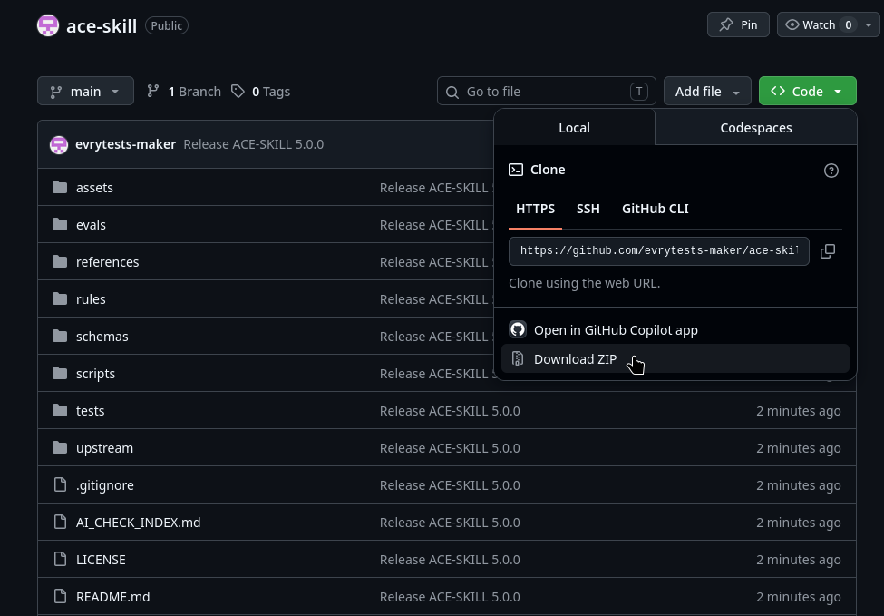
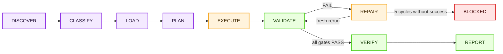

<div align="center">

# ACE-SKILL

**A skill for people who are tired of manually repairing lorebooks, guessing why a key did not trigger,  
and trusting a model's report without evidence.**

*SillyTavern character cards · Lorebooks / World Info  
· RU/EN keys · Evidence-backed validation*

[](https://github.com/evrytests-maker/ace-skill)
[](LICENSE)
[](https://nodejs.org)
[](#verification-levels)
[](https://github.com/SillyTavern/SillyTavern)

[Русская версия](README.md)

</div>

---

## Contents

**For users**

1. [What it is](#what-it-is)
2. [Quick start](#quick-start)
3. [Capabilities](#capabilities)
4. [Installation](#installation)
5. [Ready-to-use prompt examples](#ready-to-use-prompt-examples)
6. [Where it was tested](#where-it-was-tested)

**Technical description**

7. [Architecture](#architecture)
8. [Task lifecycle](#task-lifecycle)
9. [Workflows](#workflows)
10. [Rules, validators, and manual gates](#rules-validators-and-manual-gates)
11. [Statuses, repair loop, and evidence](#statuses-repair-loop-and-evidence)
12. [Sources of truth](#sources-of-truth)
13. [Verification subsystems](#verification-subsystems)
14. [CLI](#cli)
15. [Verification levels](#verification-levels)
16. [Repository structure](#repository-structure)
17. [v4.2 → v5](#v42--v5)
18. [Limitations](#limitations)

---

## What it is

`ace-skill` is a skill for AI agents and chatbots that turns work with SillyTavern materials into a verifiable process: create or repair → run checks → fix what failed → show evidence.

It is useful if you:

- write character cards from scratch or repair someone else's;
- build a lorebook / World Info and are tired of manually searching for broken entries;
- work with Russian and English keys, regex, and `keysecondary`;
- want to understand why an entry triggered or did not trigger;
- do not trust a "everything is checked" answer until the model shows real checks.

> [!NOTE]
> `ace-skill` does not make the model smarter. It sets a route for it, does not let it mix card and lorebook rules, and forbids declaring `PASS` without actually executed checks.

---

## Quick start

1. **Install** the skill into your agent or upload the ZIP into a chat — see [Installation](#installation).
2. **Attach** a character card, a lorebook, or simply describe the task.
3. **Write** what needs to be done:

```text
Use ace-skill. Check this lorebook and fix all mandatory errors.
```

After that, the skill itself selects the appropriate workflow, reads only the necessary references, performs the task, and checks the result.

**What you will get in the reply:**

- the finished file or the path to it;
- which workflow was selected and which rules were applied;
- which checks were run and what they showed;
- what broke on the first run and how it was fixed;
- the final status: `PASS`, `FAIL`, or `BLOCKED` — and why.

> [!IMPORTANT]
> `PASS` means that **all** mandatory checks were actually run and passed. If even one was not run, is unavailable, or its result is unknown, the status is `BLOCKED`, not "probably everything is fine".

---

## Capabilities

| Task | What ace-skill does |
|---|---|
| Character cards | creates and repairs V1/V2/V3 cards: structure, personality, greeting, voice, token budget |
| Lorebooks / World Info | creates, validates, and repairs entries, positions, groups, recursion, probability, sticky/cooldown/delay |
| Keys and regex | designs and tests plain keys and JavaScript regex on positive and negative examples |
| Secondary logic | validates `keysecondary`, `selective`, and all four `selectiveLogic` modes by truth table |
| Entry activation | shows which entries were activated, lost, or discarded — with UID/index and reason |
| Token budget | counts tokens for the selected profile and explicitly states where the count is exact and where it is an estimate |
| Style | catches prohibited rhetorical patterns and checks creative fields via manual gates |
| Card + lorebook | repairs both artifacts in one task but validates them separately |

---

## Installation

First determine which mode you are working in:

| Mode | Where | What is available |
|---|---|---|
| **Chatbot** | ChatGPT, Claude.ai, Grok, and other web chats | instructions, references, manual checks; automated checks only if the chat can run Node.js |
| **Agent** | Codex, Claude Code, Antigravity, Gemini CLI, OpenCode, Cursor, Cline, Roo Code | everything, including `verify.mjs`, the CLI, validators, and tests |

> [!TIP]
> A full automated `PASS` is possible only where the model can actually execute commands. In web chats without code execution, the honest result for automated checks is `BLOCKED`.

### Chat interfaces

#### How to download the ZIP from GitHub

Open the repository and click **Code** → **Download ZIP**:



GitHub names the folder inside the archive `ace-skill-main/`. If the interface installs skills and complains about the name, rename the folder to `ace-skill/` — it must match the `name` field in `SKILL.md`.

#### ChatGPT

**Option 1 — Personal Skill.** If the [ChatGPT Skills](https://chatgpt.com/skills) section is available in your account:

1. Create a new skill or choose the upload option from your computer.
2. Upload a ZIP with the `ace-skill/` folder and the `SKILL.md` file inside.
3. Invoke `ace-skill` explicitly or simply give a suitable task.

**Option 2 — ZIP directly into the chat.** If Personal Skills are unavailable, attach the archive and write:

```text
Use ace-skill from the archive. Start with SKILL.md and perform "X".
```

#### Claude.ai

1. If custom Skills upload is available in the interface (**Settings → Capabilities → Skills**), install the ZIP as a skill. Otherwise upload the archive directly into the chat.
2. Attach a character card, a lorebook, or the task text.
3. Write:

```text
Use ace-skill from the archive. Start with SKILL.md, select the appropriate workflow, and read only the necessary files.

Complete the task, show evidence, and do not declare a full PASS if the mandatory JavaScript checks were not actually run.
```

#### Grok.com

The recommended mode is **Expert**.

1. Upload the ZIP to grok.com.
2. Attach a character card, a lorebook, or the task text.
3. Write:

```text
Use ace-skill from the archive. Start with SKILL.md, select one workflow, and do not read the entire archive unless necessary.

Show what was checked, which errors were found, what was fixed, which checks were rerun, and which checks were unavailable.

Do not present BLOCKED or an unknown result as PASS.
```

#### Other chat interfaces

If the chat accepts a ZIP or multiple files, upload the archive and the material to be checked, then:

```text
Use ace-skill from the uploaded archive.

SKILL.md is the main entry point. Select one suitable workflow and read only the files it requires.

Complete the task and show evidence for every available check.

If the interface does not allow running JavaScript or Node.js, state this explicitly and return BLOCKED for the unavailable mandatory checks.
```

### Agent interfaces

Agents work with local files, so they can run `verify.mjs`, the CLI, validators, and tests. A full check requires **Node.js 20+**.

After installation in any agent, it is useful to verify the package right away — see [Verify the installation](#verify-the-installation).

#### Codex

Codex looks for skills in `.agents/skills`.

```bash
# For all projects
mkdir -p "$HOME/.agents/skills"
git clone https://github.com/evrytests-maker/ace-skill.git "$HOME/.agents/skills/ace-skill"

# Only for the current repository
mkdir -p .agents/skills
git clone https://github.com/evrytests-maker/ace-skill.git .agents/skills/ace-skill
```

If the repository is already downloaded, use `cp -R /path/to/ace-skill <directory>/ace-skill` instead of `git clone`.

Invocation:

```text
$ace-skill Check this lorebook and fix all mandatory errors.
```

You can also use a plain phrase — `Use ace-skill for this task.` Codex also selects the skill itself if the request matches its `description`.

#### Claude Code

Claude Code looks for skills in `~/.claude/skills/` (for all projects) and `.claude/skills/` (for the current project).

```bash
# For all projects
mkdir -p "$HOME/.claude/skills"
git clone https://github.com/evrytests-maker/ace-skill.git "$HOME/.claude/skills/ace-skill"

# Only for the current project
mkdir -p .claude/skills
git clone https://github.com/evrytests-maker/ace-skill.git .claude/skills/ace-skill
```

Invocation — `/ace-skill <task>` or with a plain phrase. Claude Code also loads the skill automatically based on its `description`.

If the skill sits directly inside the project (without a skills directory), specify the path explicitly:

```text
Use ./ace-skill/SKILL.md as the skill's entry point.

Select the appropriate workflow, read only the necessary references, and run the available checks through Node.js.
```

#### Antigravity

Open the project folder and clone `ace-skill` into the workspace:

```bash
git clone https://github.com/evrytests-maker/ace-skill.git
```

```text
project/
├── ace-skill/
│   ├── SKILL.md
│   ├── verify.mjs
│   └── ...
├── card.json
└── lorebook.json
```

Request:

```text
Use ./ace-skill/SKILL.md as the skill's entry point.

Select one suitable workflow, read only the files it allows, complete the task, and run the available Node.js checks.

Do not declare PASS without evidence.
```

#### Gemini CLI, OpenCode, Cursor, Cline, Roo Code

Clone `ace-skill` into the root of the working project (or next to the files being checked):

```bash
git clone https://github.com/evrytests-maker/ace-skill.git
```

Request in the agent chat:

```text
Use ./ace-skill/SKILL.md as the main instruction for this task.
Select one workflow, open only the necessary rules, complete the task, and run the available validators.
After fixes, rerun the failed checks. Do not declare PASS without evidence.
```

#### Other local agents

| Agent capability | What to do |
|---|---|
| supports Agent Skills | install the `ace-skill/` folder into its skills directory |
| works with a local repository | place `ace-skill/` inside the project and specify the path to `SKILL.md` |
| can run Node.js | first `node verify.mjs`, then the required CLI commands |
| can only read files | use the instructions, but do not expect an automatic `PASS` |
| limits the context | start with `SKILL.md`, open references only for the selected workflow |
| does not show command output | automated checks are considered unconfirmed → `BLOCKED` |

### Verify the installation

A quick package check requires no `npm install`, network access, or dependencies:

```bash
node verify.mjs                     # from the skill folder
node ace-skill/verify.mjs ace-skill # from the project root
node verify.mjs path/to/ace-skill.zip
```

Expected output:

```text
ACE WEB PRECHECK: PASS
```

> [!IMPORTANT]
> This is a package integrity check, not a release `PASS` and not an assessment of your card or lorebook. The full check is described in the [Verification levels](#verification-levels) section.

---

## Ready-to-use prompt examples

<details>
<summary><strong>Create a character card</strong></summary>

```text
Use ace-skill. Create a SillyTavern character card based on my description.
Preserve the user's initiative, write a lively greeting, and check the structure, style, and token budget.
```

</details>

<details>
<summary><strong>Repair an existing card</strong></summary>

```text
Use ace-skill. Find problems in this character card, fix them without losing the character,
and show which checks were rerun after the repair.
```

</details>

<details>
<summary><strong>Check a lorebook</strong></summary>

```text
Use ace-skill. Check the lorebook for structure, keys, secondary logic, groups, recursion,
timed effects, and token budget. Fix mandatory errors and keep the UID of each entry in the report.
```

</details>

<details>
<summary><strong>Check a regex key</strong></summary>

```text
Use ace-skill. Check this key specifically with JavaScript regex semantics.
It must match: Годжо, Gojo, Сатору.
It must not match: год, go, Сат.
```

</details>

<details>
<summary><strong>Check a card and lorebook together</strong></summary>

```text
Use ace-skill. Fix the character card and the linked lorebook in one task,
but check them with separate gate sets and do not mix the rules of the two domains.
```

</details>

---

## Where it was tested

Environments in which the author manually tested `ace-skill`. This is the author's practical experience, not the result of automated repository tests.

| Environment | Model | Reasoning level | How it was used |
|---|---|---|---|
| Codex | GPT-5.6 Terra | high, mostly xhigh | development, repository audit, fixes, and full local checks |
| Codex | GPT-5.6 Sol | high, mostly xhigh | re-checking workflows, scripts, and evidence |
| ChatGPT | GPT-5.6 Sol | high | working with an uploaded ZIP, web-compatible scenario |
| grok.com | Expert | — | working with an uploaded ZIP, web-compatible scenario |
| claude.ai | Claude Sonnet 4.6 | high/max | working with an uploaded ZIP, workflow selection, and instruction checking |

The architecture is designed to transfer to other compatible models and agents, but environments not listed here are not considered tested.

> [!CAUTION]
> The result on a specific model depends on Skills support, file access, and the ability to run commands. The table is not an assessment of the quality of the models themselves and does not promise the same result everywhere.

---

# Technical description

## Architecture

`ace-skill` consists of three layers that separate "what to do", "by which rules", and "how to verify it":

| Layer | Files | Purpose |
|---|---|---|
| **Instructions for the model** | `SKILL.md`, `references/*.md`, `AI_CHECK_INDEX.md` | entry point, state machine, invariants, domain references. `SKILL.md` is the only model-neutral entry for all agents |
| **Machine-readable rules** | `rules/*.json`, `rules/guide/*.json`, `schemas/*.json` | rule registry, workflows, manual gates, sources and conflicts, World Info rule packs. Everything is validated with JSON Schema |
| **Executable checks** | `scripts/ace.mjs`, `scripts/services/*`, `scripts/lib/*`, `verify.mjs` | a unified CLI over isolated services, a World Info simulator, a dependency-free package precheck |

Plus a self-check loop: `tests/` (unit, e2e, sabotage/mutant) and `evals/` (trigger and behavior evals).

Key decisions:

- **One entry point.** There are no parallel model-specific branches: Codex, Claude, ChatGPT, and the others all go through a single `SKILL.md`.
- **Rules are data, not prose.** The model receives a projection of the needed workflow from the registries (`ace.mjs workflow <id>`) instead of rereading long Markdown. Rule text is not duplicated.
- **Progressive disclosure.** First an inventory of input files (types, sizes, number of records), then classification, then reading only the allowed references. Files larger than 20 KiB are read in targeted fragments.
- **Domain isolation.** Card and lorebook rules are not mixed: each workflow has `requiredReferences` and `forbiddenReferences` lists.
- **Fail-closed.** Anything unknown, not run, or contradictory counts as a failure, not a success.

---

## Task lifecycle

Every task goes through a fixed state machine:



| State | What happens |
|---|---|
| `DISCOVER` | inventory of input artifacts and constraints; missing data is requested only if it cannot be extracted from the files |
| `CLASSIFY` | selection of exactly one workflow; `node scripts/ace.mjs workflow <id> --json` returns its rules, validators, gates, sources, and conflicts |
| `LOAD` | reading mandatory references while recording the path and SHA-256; reading a forbidden reference is a violation of `ACE-CORE-002` |
| `PLAN` | each applicable rule is linked to a result and a gate; an "orphaned" MUST blocks further progress |
| `EXECUTE` | creating or repairing the artifact while preserving the user's constraints |
| `VALIDATE` | running all applicable validators through the CLI and answering manual gates with quotes from the fields |
| `REPAIR` | recording the failure → fixing → rerunning the same gate from a clean state; maximum 5 full cycles |
| `VERIFY` | reopening the final files, validating the evidence ledger; if available — an independent grader with fresh context |
| `REPORT` | status for each gate and the overall status according to the output contract |

---

## Workflows

The registry is `rules/workflows.json`. Each task is classified into exactly one workflow:

| Workflow | When | Validators | Manual gates |
|---|---|---|---|
| `character-create` | a new card or its fields | CARD, STYLE, TOKENS, EVIDENCE | CHARACTERIZATION, GREETING, VOICE, STYLE-CONTRAST |
| `character-repair` | card audit/repair | CARD, STYLE, TOKENS, EVIDENCE | CHARACTERIZATION, GREETING, VOICE, STYLE-CONTRAST |
| `lorebook-create` | a new World Info / lorebook | LORE, KEY, SECONDARY, STYLE, TOKENS, SOURCES, EVIDENCE | LORE-SEMANTICS, LORE-KEYS, STYLE-CONTRAST |
| `lorebook-audit` | lorebook audit/repair | LORE, KEY, SECONDARY, STYLE, TOKENS, SOURCES, EVIDENCE | LORE-SEMANTICS, LORE-KEYS, STYLE-CONTRAST |
| `key-regex-test` | key/regex design and testing | KEY, SOURCES, EVIDENCE | LORE-KEYS |
| `secondary-logic-test` | truth table of secondary keys | LORE, KEY, SECONDARY, SOURCES, EVIDENCE | — |
| `token-budget` | token counting only | TOKENS, EVIDENCE | — |
| `combined-repair` | card and lorebook together | all domain validators | all domain gates + COMBINED-SEPARATION |
| `skill-maintenance` | changes to ace-skill itself | RULES, DOCS, SOURCES, LANGUAGE, EVIDENCE, EVAL-DATA | — |

The `VAL-` and `MG-` prefixes are omitted. Domain references: cards — `references/character-cards.md`, lorebooks — `references/lorebooks.md`, keys — `references/keys-and-regex.md`; for `combined-repair` all three are loaded, but gates and evidence are kept separately (`ACE-OUTPUT-001`).

---

## Rules, validators, and manual gates

### Rule registry

`rules/registry.json` — 26 rules with a level, scope, and link to validators. Levels:

| Level | Meaning |
|---|---|
| `MUST` | an applicable failure blocks `PASS` |
| `SHOULD` | followed by default; an exception requires a recorded reason |
| `MAY` | method chosen by the agent |
| `JUDGMENT` | quality is mandatory, but the artistic method is not prescribed — checked by a manual gate |

Rule groups:

| Group | What it covers |
|---|---|
| `ACE-TRIGGER-*`, `ACE-CORE-*` | when to activate, state machine order, mandatory reading of references, prohibition of `PASS` without fresh evidence, repair loop |
| `ACE-CARD-*` | structural contract for V1/V2/V3, character through behavior, a playable greeting that makes no decisions for the user, voice in dialogue examples, advisory 700–1500 tokens |
| `ACE-LORE-*` | valid entry structure, `selectiveLogic` strictly `0..3`, `selective=true` when secondary keys are non-empty, semantic self-sufficiency of entries |
| `ACE-KEY-*` | JavaScript regex semantics, positive and negative cases, semantic connection of the key to the content |
| `ACE-STYLE-*` | prohibition of the "X — not A, but B" rhetoric at the level of patterns and meaning (RU and EN) |
| `ACE-TOKEN-*` | specifying the counting method, prohibition of presenting an estimate as an exact count |
| `ACE-SOURCE-*` | technical statements about SillyTavern — only from an official source; conflicts are resolved explicitly |
| `ACE-REPO-*`, `ACE-OUTPUT-*` | repository integrity, coverage of each MUST by a validator and a test, English as the language of active prose, self-contained execution, domain separation in combined tasks |

The agent must not invent rule IDs: everything it references must exist in the registry.

### Validators

18 validators in the registry. Domain validators:

| ID | Command | What it checks |
|---|---|---|
| `VAL-CARD` | `validate card` | V1/V2/V3 version detection, `spec`/`spec_version`, mandatory string fields, `extensions`, `assets`, `character_book` |
| `VAL-LORE` | `validate lorebook` | the `entries` container (object or array), field types, integer IDs, conflicting field aliases, unknown `selectiveLogic` without fallback, hints for typos in field names |
| `VAL-KEY` | `key` | key compilation, positive/negative cases, secondary keys with `--logic 0..3`, `{{char}}`/`{{user}}` macros |
| `VAL-SECONDARY` | `secondary` | full truth table of `keysecondary` × `selectiveLogic` |
| `VAL-STYLE` | `validate style` | contrastive negation patterns (`EN-NOT-BUT`, `RU-NE-A-NO`, and variants with repetition or a named subject) |
| `VAL-TOKENS` | `tokens` | counting by field, method (`exact`/`estimate`/`mixed`), budget, advisory for the card |
| `VAL-SIMULATOR` | simulator tests | World Info pipeline model; mandatory for "advanced" lorebooks |
| `VAL-SOURCES` | `validate sources` | freshness (`reviewDue`), hierarchy and resolution of source conflicts |
| `VAL-EVIDENCE` | `validate evidence` | structure and completeness of the evidence ledger |

Repository validators: `VAL-SYNTAX`, `VAL-RULES`, `VAL-DOCS`, `VAL-LANGUAGE`, `VAL-UNIT`, `VAL-E2E`, `VAL-SABOTAGE`, `VAL-EVAL-DATA`, `VAL-EVAL`.

### Manual gates

What cannot honestly be reduced to an automated check is verified with structured questions from `rules/manual-gates.json`. The answer must rely on direct quotes from the artifact's fields.

| Gate | Question |
|---|---|
| `MG-CARD-CHARACTERIZATION` | is motivation shown through behavior, with inner state separated from outward manner? |
| `MG-CARD-GREETING` | does the greeting give a playable start without deciding the user's thoughts, lines, and choices? |
| `MG-CARD-VOICE` | do the dialogue examples show the intended voice and not contradict the card? |
| `MG-LORE-SEMANTICS` | is the entry understandable when activated and limited to the needed information? |
| `MG-LORE-KEYS` | do the keys recognize the entry's topic in the chat's language without broad false triggers? |
| `MG-STYLE-CONTRAST` | is the prose free of replacement-by-negation, including split and paraphrased variants? |
| `MG-COMBINED-SEPARATION` | did the card and the lorebook get separate references, rules, validators, gates, and evidence? |

---

## Statuses, repair loop, and evidence

### Statuses and exit codes

| Status | Exit code | Meaning |
|---|---|---|
| `PASS` | `0` | check executed and passed |
| `FAIL` | `1` | validation failed |
| — | `2` | usage or input error |
| `BLOCKED` | `3` | check cannot be executed: no capability, no input, or 5 repair cycles did not help |
| `N/A` | — | gate is not applicable; requires a recorded reason and a list of checked fields |

The overall `PASS` requires that all applicable MUST rules and manual gates are `PASS`, that there is no `FAIL`/`BLOCKED`, and that every `N/A` is justified. `PASS` is also blocked when command output is missing, when a critical field has an unknown value, and when a source conflict is unresolved.

### Repair loop

For each failure, the following is preserved: the failed rule/gate and its cause → the fix → a rerun of the same gate from a clean state. **Both** attempts remain in the evidence — the failed one and the fixed one. If the same mandatory problem persists after five full cycles, the outcome is `BLOCKED`.

### Evidence ledger

Evidence is the real output of a command, an excerpt or hash of an artifact, a transcript event, or an independent review. A checkmark or a model's assertion is not evidence.

The ledger is described in `schemas/evidence.schema.json` and contains: `runId`, `repoHead`, `revisionKind`, `workflowId`, `artifactType`, `startedAt`/`finishedAt`, `inputs`, `transitions` (state machine transitions), `references` (path + SHA-256), `gates` (command, exit code, hash, reruns), and `overallStatus`. Repository checks write the ledger to `.ace-reports/`.

Lorebook reports keep, for each row, the entry UID/index, the path to the source field, the final status, and a stable reason code — a condensed report may not lose provenance from the trace.

---

## Sources of truth

SillyTavern's technical behavior is taken only from official code and documentation. `rules/sources.json` defines the hierarchy:

```text
official-source > official-documentation > observed-behavior > local-practical-guide > community-guide > legacy-ace
```

- **17 sources**; the official code is pinned to the SillyTavern revision [`8172dcd`](https://github.com/SillyTavern/SillyTavern/blob/8172dcd0ee672d3cd9a5e5f7af134f91a45cd2b8/public/scripts/world-info.js) (`world-info.js`, `macros.js`, `TavernCardValidator.js`). A copy of the key reference is in `upstream/`.
- Each source has `checkedAt` and `reviewDue`. An overdue source fails `VAL-SOURCES` — outdated knowledge does not pass silently.
- **4 registered conflicts** between guides and implementation (scan depth counting, merging of vector results, "hard" creative limits, the default World Info insertion strategy), with explicit resolutions.
- **Rule packs** `rules/guide/*.json` — 92 rules in 7 thematic packs (format and entries; scanning and keys; placement, probability, and budget; recursion and groups; timed effects and filters; vectors; card). Community guides in them are qualified by the pinned official source: where they diverge, the code wins.
- Execution is self-contained: external URLs are needed only for provenance; nothing is downloaded during operation.

---

## Verification subsystems

### World Info simulator

`scripts/lib/world-info-simulator.mjs` — a deterministic model of the World Info pipeline that reproduces the behavior of the official `release` branch:

- scan buffer taking into account `scanDepth` (counted by messages), participant names, and macros;
- primary/secondary keys, plaintext and regex, case sensitivity and whole words;
- filters by characters and tags, `constant`, `enabled`;
- groups, group scoring, weights, and `groupOverride`;
- recursion with `excludeRecursion` / `preventRecursion` / `delayUntilRecursion` and a step limit;
- timed effects `sticky` / `cooldown` / `delay`;
- `probability` via seeded PRNG — the result is reproducible;
- source strategies (character first, global first, evenly), `minActivations`, token budget, and `ignoreBudget`;
- insertion positions (`before_char` … `at_depth`, `outlet`), prompt skeleton assembly, and expansion of Outlet macros;
- vector retrieval — through an explicit adapter; real embeddings and Quick Reply remain runtime-dependent and are not presented as a runtime `PASS`.

Every decision is recorded in the trace with its reason: activated, lost within a group, discarded by budget, blocked by a timer, etc.

### Keys and regex

Keys are checked strictly with JavaScript `RegExp` semantics — Python regex is not accepted as final evidence. Both positive and meaningful negative cases are required. Russian regex, keys, and test literals are stored byte-for-byte and are never translated. `--syntax-only` checks only compilation and does not yield a behavioral `PASS`. `lorebook-keys` runs the entire lorebook against chat text with the expected active/inactive entries.

### Tokens

| Profile | Tokenizer | Method |
|---|---|---|
| `gpt-5`, `gpt-4o` | `o200k_base` | exact (`gpt-tokenizer`) |
| `gpt-3.5` | `cl100k_base` | exact (`gpt-tokenizer`) |
| `claude`, `gemini`, `llama`, `mistral`, `generic` | — | estimate by character class (Latin, Cyrillic, CJK, digits, punctuation) |

The method is always stated in the report; if fields were counted with different methods — `mixed`. `--require-exact` returns `BLOCKED` when no exact tokenizer is available; `--budget N` gives `FAIL` when exceeded. For a full card, the 700–1500 token range is advisory only: outside the range it gives `WARN` with the actual number; the card does not fail because of it.

### Style

The ban on replacement-by-negation ("X — not A, but B", "not A, but B", and equivalents) works in two layers: `VAL-STYLE` catches patterns in Russian and English, `MG-STYLE-CONTRAST` catches semantic variants that bypass the patterns. Ordinary factual negation without substitution is allowed.

### Package precheck

`verify.mjs` — a single Node.js process using only built-in modules, with no network, npm, or temporary files. It accepts a skill folder, a parent folder with several skills, a ZIP, or any file inside an installed skill. Checks: `SKILL.md` metadata, structure and required files, SHA-256 of all files per `verification-manifest.json`, JSON validity, local Markdown links, path case, `package.json`, the Outlet contract, source conflicts, and the release gate structure. Warns about `.git`, `node_modules`, `.ace-reports`, and large files.

---

## CLI

All checks run through the unified `scripts/ace.mjs`. Domain commands:

```bash
node scripts/ace.mjs validate card card.json
node scripts/ace.mjs validate lorebook lorebook.json
node scripts/ace.mjs validate style artifact.json

# One key with a positive and a negative example
node scripts/ace.mjs key \
  --key '/(?:Годжо|Gojo)/iu' \
  --should-match 'Годжо вошёл в комнату' \
  --should-not-match 'Это был обычный год'

# Whole lorebook against chat text
node scripts/ace.mjs lorebook-keys lorebook.json --text 'Годжо вошёл' --expect-active 3

# Secondary logic
node scripts/ace.mjs secondary tests/key-fixtures/secondary_lorebook.json

# Tokens
node scripts/ace.mjs tokens card.json --model gpt-4o --budget 1500

# Workflow projection: rules, validators, gates, sources
node scripts/ace.mjs workflow lorebook-audit --json
```

Service commands: `validate rules|docs|sources|language`, `validate evidence <ledger.json>`, `repo syntax|fast|all`, `eval triggers|behavior|all`. The `--json` flag gives machine-readable output for all commands. Full help — `node scripts/ace.mjs --help`; the map of checks — `AI_CHECK_INDEX.md`.

---

## Verification levels

| Level | Command | What it confirms | Requirements |
|---|---|---|---|
| Precheck | `node verify.mjs` / `npm run check:web` | package integrity and structure | Node.js 20+ only |
| Local | `npm run check:local` | fast gate: syntax, rules, docs, sources, language, domain validators on fixtures, simulator, unit/sabotage/e2e, evidence | `npm ci` |
| Release | `npm run check:all` | everything from Local plus validation of evals data — the full local release gate | `npm ci` |
| Runtime | `npm run check:runtime` | trigger and behavior evals on a real model | external model runner; otherwise `BLOCKED` |

```bash
npm ci --ignore-scripts --no-audit --no-fund
npm run check:local
npm run check:all
npm run check:runtime
```

Test suite:

- **unit** — CLI contract, services, truth table, tokens, language, self-contained, official World Info semantics, simulator;
- **e2e** — assembly of the prompt skeleton with provenance and Outlet;
- **sabotage / mutant** — deliberately corrupted states: a false `PASS`, replaced data, lost provenance, broken secondary logic, validator mutants. They verify that ace-skill catches them;
- **evals** — trigger evals with a train/validation split (when the skill should and should not activate) and behavior evals with a grader (`evals/grader.md`).

---

## Repository structure

```text
ace-skill/
├── SKILL.md                     # entry point for the model
├── AI_CHECK_INDEX.md            # which check to run
├── README.md / README_EN.md     # documentation
├── verify.mjs                   # dependency-free precheck of a folder/ZIP
├── verification-manifest.json   # SHA-256 of files and package requirements
├── package.json                 # npm scripts, Node.js 20+, devDependencies
│
├── references/                  # domain references for the model
│   ├── character-cards.md
│   ├── lorebooks.md
│   ├── keys-and-regex.md
│   ├── sources-and-conflicts.md
│   ├── skill-architecture-research.md
│   └── migration-notes.md
│
├── rules/
│   ├── registry.json            # rules and validators
│   ├── workflows.json           # 9 workflows
│   ├── manual-gates.json        # structured manual checks
│   ├── sources.json             # sources, hierarchy, conflicts
│   ├── language-exceptions.json # allowed Cyrillic literals
│   ├── maintenance-exclusions.json
│   └── guide/                   # 7 rule packs for World Info and cards
│
├── schemas/                     # JSON Schema for rules, workflows, gates, sources, evidence
├── scripts/
│   ├── ace.mjs                  # unified CLI
│   ├── token_model_map.mjs      # tokenizer profiles
│   ├── services/                # card, lorebook, key, secondary, style, tokens, workflow, repo-check
│   └── lib/                     # World Info simulator, enforcement, evidence, IO, matching
├── tests/                       # unit, e2e, sabotage, fixtures
├── evals/                       # trigger/behavior evals, input data, grader
├── assets/                      # card/lorebook templates, README images
└── upstream/                    # pinned official SillyTavern reference
```

Dependencies (dev only): `ajv` — schema validation, `gpt-tokenizer` — exact counting for OpenAI, `yaml` — frontmatter parsing.

---

## v4.2 → v5

v4.2 was a folder with instructions, references, and separate scripts. v5 is a cohesive system: one entry point, one task router, one CLI, machine-readable rules, a mandatory repair loop, and evidence without which `PASS` cannot be declared.

| Area | v4.2 | v5.0 |
|---|---|---|
| Entry point | general `SKILL.md` + separate GPT layer | one model-neutral `SKILL.md` |
| Task selection | text instructions | exactly one workflow from the registry |
| Rules | prose documents | rule registry, workflows, manual gates, schemas, source conflicts |
| Checks | separate scripts | unified `scripts/ace.mjs` CLI |
| Error handling | explanation of the problem | `FAIL → repair → fresh rerun`, up to 5 cycles |
| Final status | depended on model honesty | fail-closed |
| Evidence | scattered results | ledger with commands, exit codes, hashes, and reruns |
| Context | many references at once | progressive disclosure |
| Technical sources | practical instructions | pinned official SillyTavern + conflict registry |
| ZIP check | full environment or manual inspection | `verify.mjs` without network or npm |
| Tests | regression | unit, e2e, trigger/behavior evals, sabotage/mutant |

Migration details — `references/migration-notes.md`.

---

## Limitations

- `ace-skill` checks only what the agent has access to. Without command execution, a full automated `PASS` is impossible.
- Artistic quality is not reduced to a number — manual gates are used for it, not hard length limits.
- Exact token counting is available only for OpenAI tokenizers; for other profiles it is an estimate, and this is always stated.
- SillyTavern's behavior changes between versions. Technical statements are tied to the pinned revision and require source updates when `reviewDue` arrives.

---

## License

MIT — see [LICENSE](LICENSE).
